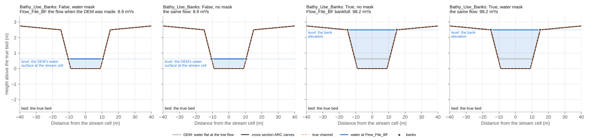
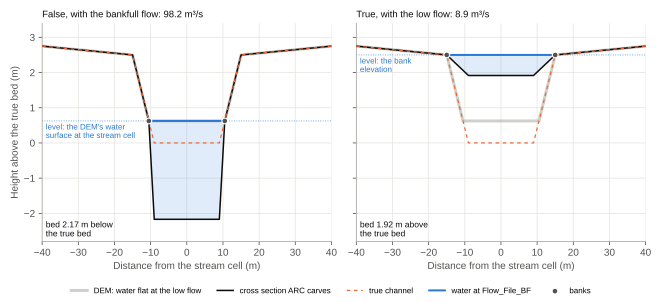
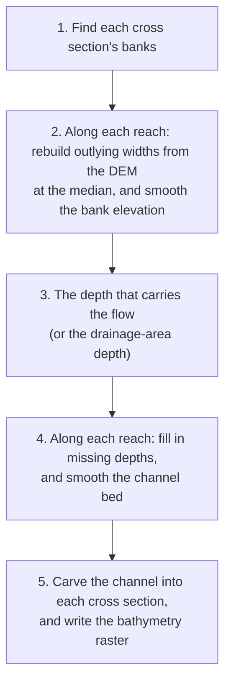
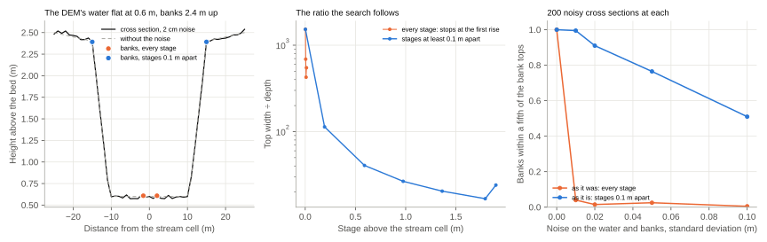
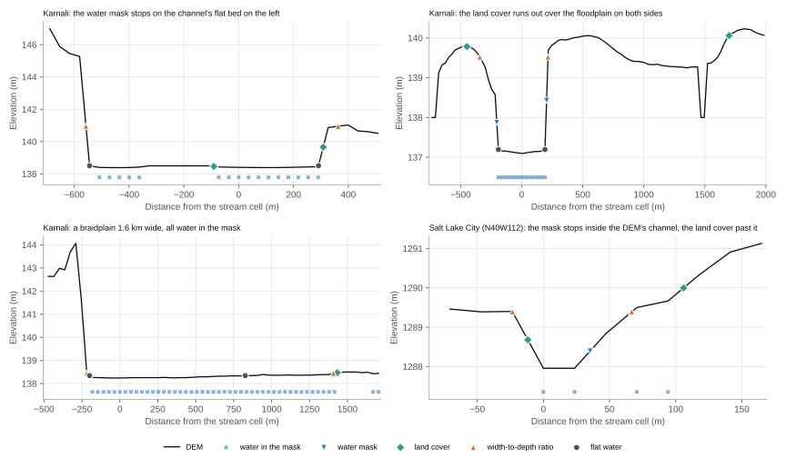

# Bathymetry

A DEM usually shows the water surface, not the channel bed beneath it, so the channel looks smaller than it is and the
rating curves carry too little flow at low water. ARC can estimate the missing part of the channel and carve it into
each cross section. Give `BATHY_Out_File` to turn this on.

!!! danger "Match `Flow_File_BF` to `Bathy_Use_Banks`"
    `Flow_File_BF` must be the flow that fills each channel exactly to the level `Bathy_Use_Banks` names: the DEM's
    water surface without it (a low flow, the baseflow), the bank elevation with it (bankfull). A water mask doesn't
    change that: with `Bathy_Use_Banks` the banks are the bank tops, mask or not. A mismatched pair
    carves the bed metres too deep, or fills the channel in metres too high, and ARC can't tell: there is no error or
    warning. Check the pair before every run with bathymetry. See
    [Water surface or banks](bathymetry.md#water-surface-or-banks).

!!! tip "Recommended"
    Give a water mask (`BathyWaterMask`) if you have one, and otherwise set `FindBanksBasedOnLandCover: True`. Give a
    width power law (`drainage_area_field`, `coefficient_width`, `exponent_width`) for the channels too narrow to see.
    Pick `Flow_File_BF` to go with `Bathy_Use_Banks`, as below, and keep `Bathy_Smooth_Banks` on. See
    [Recommended settings](model_input_file.md#recommended-settings) for why.

## Water surface or banks

A DEM shows each river full to some level. Most DEMs show the water's surface at whatever flow the river carried when
they were made, usually a low one. `Bathy_Use_Banks` says which level ARC takes the channel to be full to, and
`Flow_File_BF` has to be the flow that fills it to that level. Either way ARC carves the same trapezoid between the
banks, just deep enough that `Flow_File_BF` fills it exactly to that level by Manning's equation, so the flow is what
sets the depth, and the mode and the flow have to go together.

| | `Bathy_Use_Banks: False` (the default) | `Bathy_Use_Banks: True` |
| --- | --- | --- |
| The level the channel is full to | The DEM at the stream cell: the water's surface when the DEM was made. | The bank elevation: the reach's bank height above its stream (step 2 below). |
| The banks | The DEM's water's edge, where it meets the land, with or without a mask (step 1). | The bank tops, where the water spills from the channel, with or without a mask (step 1). |
| `Flow_File_BF` | The flow when the DEM was made: a low flow, the baseflow. | The flow that fills the channel to its banks: bankfull, or a channel-forming flow such as the 1.5- to 2-year flood. |
| The channel | Carved below the DEM: it only ever lowers it. | Rebuilt below the banks: it can raise the DEM as well as lower it. |
| The rating curve at `Flow_File_BF` | At the DEM's water surface (see below). | At the bank elevation (see below). |
| With `Standard_Step`, the water at flows up to `Flow_File_BF` | Held at most at the DEM's water surface. | Held at most at the bank elevation. |

The depth is worked out on the carved cross section by the rating curves' own hydraulics: the same Manning's n,
varying with depth as `Depth_Varying_N` says, and the same `slope_adjustment_factor`. So whatever those settings, the
rating curve carries `Flow_File_BF` at normal depth exactly at the level. Depth-varying n is rougher in shallow water,
so with it a channel is carved about a tenth deeper than with a constant n (the default). The standard step holds the
water only at cross sections whose depth came from `Flow_File_BF`, not from the drainage-area depth law (see [Keeping the baseflow in its banks](standard_step.md#keeping-the-baseflow-in-its-banks)).

The figures show a river whose channel is known, which `testing/test_bathymetry_modes.py` runs ARC on: a trapezoid
18 m wide at the bed, with banks 2.5 m high and 30 m apart, and a DEM made at a flow of 8.9 m³/s, which shows the
water flat 0.63 m above the bed. Given the flow that goes with its level, each mode carves the true channel, with a
water mask or without:

Given the other mode's flow, each carves the wrong channel, by metres:

- The bankfull flow below the water's surface carves the bed 2.2 m too deep.
- The low flow below the banks fills the channel in: its bed is 1.9 m above the true one, and 1.3 m above the water
  the DEM shows. The banks then hold only the low flow, and bigger floods spill over them.
The mask doesn't change the level. Without `Bathy_Use_Banks` the banks are the DEM's water's edge, mask or not, so
the carve never reaches the bank faces above the water, and with it they are the bank tops, mask or not, so a bankfull
`Flow_File_BF` fills the true channel. (Before 2026-10-28 a mask's banks were the water's edge in both modes, so with
`Bathy_Use_Banks` and a bankfull flow the bed came out 2.4 m too deep, and without a mask the water-surface mode
carved as wide as the bank tops below the water.)

In a canyon, with `Bathy_Use_Banks`, the banks the DEM shows (a bench in its walls, or its rim) can be far above the
bankfull water, and carving the flow to fill the channel to them would build the bed up metres above the DEM's water.
So no bank is taken above the water that carries the cross section's maximum flow over the DEM (step 1): in the test
canyon, whose bench is 10 m up and whose maximum flow stands about 5 m up the walls, the banks are the walls 4 m up and
the bed is raised 2 to 3 m rather than 6 m. A hydro-conditioned DEM's channel can look the same: the Flint River at
Albany is a trench 8 m deep in FABDEM, its water 7 m below the USGS lidar's, and the Karnali's gorge is a burned line
one or two cells wide where the raw DEM shows no gorge at all. There raising the bed is right, and where the maximum
flow tops the trench, its rim is taken and the bed raised.

A trapezoid can match the true channel only where it has the same shape. `Bathy_Trap_H` is the share of the top
width each sloping side takes: 0.2 (the default) matches this river below its banks, and 0.07 matches it below its
water, which has a narrower top over the same bed. The figures use each mode's own share.

Either way, a drainage-area power law can set the depth instead of the flow:
depth = `coefficient_depth` × drainage area ^ `exponent_depth`.

## The steps

### 1. Find the banks

What a bank is depends on the mode. Each method keeps a channel only if it is at least twice as wide as the distance
between the cross section's points (two cells); see below for narrower ones.

**The water level** is the DEM's water's surface: the stream cell's elevation, except where it is burned below the
water. Where the water mask's (or the land cover's) water next to the stream cell is flat, two cells or more within
0.1 m of each other on a side, the level is their median. A cell half water and half bank at the water's edge stands
above the water, and the floodplain a mask that spills onto it higher still, so neither raises the level.

**Without `Bathy_Use_Banks`: the DEM's water's edge.** The DEM shows the water, so the banks are where the water meets
the land: half way between the last cell out from the stream cell no more than 0.1 m above the water level and the first
cell above it, so that n cells of water make a channel n cells wide, and the first cell of land stays outside the
channel and keeps its elevation. The width-to-depth ratio isn't used: it finds the bank tops, and carving below the
water as wide as them lowers the bank faces. A water mask only stops the DEM's water running more than two cells past
the mask's edge, as it does across a floodplain at the water's level; a mask wider than the DEM's water doesn't widen
the channel. On 2,688 synthetic channels with exact, narrow, wide, shifted and spilling masks, the carve lowered land
above the water at 4% of them, against 29% with an exact mask and 94% with a wrong one for the order below; on the 68
FIM sites, at none of the cross sections, against 48%. The carve stops at the water's edge, but the channel doesn't: the
hydraulics divide the carved cross section at its bank tops, found as without bathymetry (below), and give the water's n
out to them, so that the bank faces above the water carry the channel's water at higher flows rather than the
floodplain's. On the synthetic channels whose carve resolved, dividing at the water's edge left the water at twice
bankfull more than 0.1 m off the same carve divided at the true bank tops at 20% of them, against 3% at the bank tops;
on six real sites it moved the division at 30 to 57% of the cells, and lowered the water at the maximum flow a median 0
to 8 cm.

**With `Bathy_Use_Banks`: the bank tops.** The banks are where the water spills from the bankfull channel, mask or
not: the width-to-depth ratio (method 2 below) over the levels above the water level, never stopping inside the DEM's
water, and never above the water that carries the cross section's maximum flow over the DEM, since a bank higher than
any flood is a valley wall. If the ratio is still falling at the highest level below that water, that level's water's
edges are the banks. Where it finds no banks, they are the water's edges (the DEM's, or the mask's). On the synthetic
channels the bankfull level was within 0.3 m of the truth at 63% of them, against 21% for the mask's edge, and on the
FIM sites banks above the maximum flow's water fell from 11% of cross sections to 0.4%.

**Without bathymetry: the bank tops too.** The banks divide each cross section into its channel and overbanks (in every
mode, the hydraulics divide at the bank tops): the channel takes the water's Manning's n, the conveyance is the sum of
the three parts', and with [Valley_Sections](valley_sections.md) the overbank lines start at the banks and the valley is
taken over `Valley_Dir_Widths` times their width. The divided-channel method divides at the bank tops, so ARC finds them
as with `Bathy_Use_Banks`, mask or not, and no higher than the maximum flow's water: on five FIM sites run without
bathymetry, 9 to 28% of the banks found without that limit were above it, valley walls that would give the floodplain
below them the water's n and stretch the valley's window. Where the ratio is still falling at that water, the channel
holds it, and the banks are its edges (with `Bathy_Use_Banks`, the highest level's below it, a bank on the ground), so
that the hydraulics don't divide it. Water the standard step backs up above it, behind a lake or a confluence, is
divided there (see [Limitations](limitations.md)). A run that only builds representative cross sections reads no maximum
flow, so its banks aren't held below it. Before 0.5.0 it took the water mask's edge first, the low water's, partway down
the bank faces. On the synthetic channels with the DEM showing the bed, those banks were within 0.3 m of the bank tops
at 19% of them (3% with an exact mask), against 56%. The bank faces above the low water went to the overbanks with the
land's n, so the water at twice bankfull was more than 0.1 m off at 35% of them, against 13%. And the valley's window
fell to about 10 channel widths, which turned its direction a median 8° on natural meanders.

The methods the modes use:

1. **Water mask or land cover.** With a water mask (`BathyWaterMask`), the banks are where its water ends, walking
   out from the stream. Without one, with `FindBanksBasedOnLandCover`, they're where the land cover's water class
   (`LC_Water_Value`) ends. The stream cells count as water in both. Each bank is half way between the last point of
   water and the first dry one, and its elevation is the ground's there. Its edge holds the DEM's water without
   `Bathy_Use_Banks`, and is the banks where nothing else finds any otherwise.

    Give a water mask if you have one. Its flat water gives the water level, and the DEM's water isn't always flat:
    a water surface that dips a few centimetres towards the stream, as some DEM conditioning leaves it, looks to the
    width-to-depth ratio like a channel only a few cells wide, unless its search starts above the water.

    

2. **Width-to-depth ratio.** As water fills a channel, its top width over its depth falls; once it spills over the
   banks, the ratio rises. The banks are where the water is at the last level before the ratio rises
   (Knighton, 1984). The levels tried are the heights of the cross section's points above the stream, lowest first,
   out on each side to the first point more than 25 m above the stream, and each at least 0.1 m above the last one
   tried (the highest is always tried). On a DEM whose water or bed has a few centimetres of noise, trying every level,
   the water spilled from one dip of the noise into the next in its first centimetres, the ratio rose, and the search
   stopped with banks a few metres apart inside the channel: on the 68 FIM test sites a tenth of these banks were
   inside the water mask's water, and on the Karnali a fifth. With the levels 0.1 m apart, 1% and 5%.

    

    

3. **The DEM's water's edge.** Where the ground first rises more than 0.1 m above the water level: half way to that
   cell without `Bathy_Use_Banks`, and where the ground crosses that height otherwise, where no bank tops are found.

    

Where a method's water runs off the edge of the raster on one side, it finds no bank there: the water's edge is the
raster's, not a bank. The methods that read the DEM also find no bank on a side where the ground under the water falls
more than 2 m below the stream: the water there drains away from the stream, as down a valley side from a stream on it,
and the ground that stops it is the valley's far side, kilometres out, not a bank.

If none of them finds a channel:

4. **A channel too narrow to see.** If the width power law (`coefficient_width`, `exponent_width`) gives a channel no
   wider than the distance between the cross section's points, about a cell, the channel is that wide, even if that's
   narrower than a cell.

Otherwise the channel takes its reach's median width (step 2), or failing that, the width power law's width, or one
cell.

The width power law comes last so that it doesn't override the banks the water and the DEM show. Before them, on the
68 FIM test sites with nencarta's power law (2.44 × drainage area in km² ^ 0.34) on every reach, it made 79% of the
stream cells single cells whatever their water mask showed, and the flood maps' mean MCC went from 0.5589 to 0.5593;
after them, to 0.5659. After them, a creek too narrow for the DEM to show, where the methods find banks at only a few
of its cross sections (the odd rise on a flat valley floor, hundreds of metres apart), is a single cell along most of
its reach, so its reach's median width is a single cell's too, and the few wide banks are rebuilt at that width
(step 2). Without the power law, such a creek in Salt Lake City (N40W112) took the median of those few banks, and was
carved 262 m wide.

The limit is one cell at any resolution. Legacy ARC allowed two below 15 m, which on a 10 m DEM let the power law
override channels the DEM does show. On three FIM sites' 10 m USGS DEMs:

| Site | Single cells with two (of all cross sections) | Mean MCC, two → one | Water at the middle flows |
| --- | --- | --- | --- |
| Salt Creek at Wood Dale | 300 of 519 | 0.428 → 0.392 | 2.3 to 3.4 m lower |
| Big Creek near Alpharetta | 1,407 of 2,406 | 0.776 → 0.756 | 0.3 to 0.4 m lower |
| Saluda River near Greenville | 7 of 1,778 | 0.866 → 0.866 | the same |

On the two creeks the single cells took the power law's 14 to 15 m, and with more than half the cross sections they
set their reaches' median width, so that step 2 rebuilt the banks the DEM did show at that width: Big Creek's,
32 m apart by the width-to-depth ratio, were carved 15 m wide. With one cell they keep their width, and the cross
sections without banks take the reach's median, 23 to 32 m. The wider channels are shallower (Big Creek's, 3.6 m
deep below the bank elevation, became 2.0 to 2.4 m; Salt Creek's, on a slope of 4.5 × 10⁻⁶, 16.8 m became 10 m) and
carry their flows lower, which their maps, flooding too little already at their lower stages, scored worse for.
FABDEM's points are 25 m or more apart, so it was already one cell there.

The methods find different things. A water mask, the land cover and the DEM's water find the water's edge; the
width-to-depth ratio finds the top of the banks, where the water would spill out. And they don't always agree on real
rivers: the water mask can stop short on a channel's flat bed, or the land cover run out onto a floodplain
(`testing/test_bank_detection.py` checks each of them on channels whose banks are known):

A cross section without banks is all channel to the hydraulics, without bathymetry.

### 2. Smooth the banks along each reach

The stream network (`StrmShp_File`, with `reach_id` and `downstream_reach_id`) puts each reach's cross sections in
order from upstream to downstream. Then:

- A channel narrower than the reach's 25th percentile width or wider than its 75th, or one without banks, gets the
  reach's median width instead. Banks at the water's edge (the water mask's, the land cover's, or the DEM's without
  `Bathy_Use_Banks`) are kept as they are: the water shows how wide the channel is, where the DEM's bank tops are only
  an estimate.
- The bank elevation follows the stream: it is the stream's elevation, made never to rise downstream, plus a bank
  height, the 10th percentile of the heights of the banks within 500 m along the reach. So a few low banks can't pull
  a whole reach down. With `Bathy_Use_Banks`, the channel is rebuilt below this elevation. A bank's height is that of
  the lower of its cross section's two banks above its stream, and where a reach has four or more, those below the
  reach's 2nd percentile or above its 97th are left out.

  Where fewer than 5 banks are within 500 m, the height is the 10th percentile of the 5 nearest along the reach, or of
  all the reach's if it has fewer. Of one bank, the 10th percentile is its height, and of two, a tenth of the way from
  the lower to the higher, however high they are.
  Where a creek is too narrow for the DEM to show its banks, ARC finds only the odd rim of the floodplain: one, 0.92 m
  up, set the bank height for a whole kilometre of a creek in N39W109, and the bed there came out 0.96 m above the
  DEM. With the 5 nearest it is at most 0.17 m above it.

  The heights are those of the banks as found in step 1, not of the median-width banks the step above gives: those
  are just the ground wherever the median width puts them, and in a gorge they land far up its walls. Nor does a bank
  from the DEM (or a single cell's, which is the ground beside the stream cell) count if it is higher than the water
  that carries the cross section's maximum flow over the DEM's own cross section: no flood reaches it, so it's a
  valley wall. Where a small creek in a V-shaped valley is too narrow
  for the DEM or the water mask to show, those walls are all ARC finds; counting them put a Karnali tributary's bank
  elevation, and so its 2-year water, 10 m above the stream. A reach left without a bank of its own takes the site's
  bank height. Only where the maximum flow stays below every bank in the site (deep channels, and no water mask) are
  the DEM's banks all kept, as the only estimate there is.

  A cross section whose banks weren't found in step 1 (none, or only a single cell's) has no real bank of its own:
  its bank elevation comes from the banks around it. Where a creek is too narrow for the DEM to show, the ground beside it can lie below that
  level, on a street or down the side of a fan, and the flood map then spreads the baseflow away from the creek. So
  with `Bathy_Use_Banks`, such a cross section on a baseflow below `Bathy_Bankless_Max_Baseflow` (20 m³/s by default)
  carries its baseflow at its stream's level instead. Beside one creek in Salt Lake City (N40W112) the 2-year flood
  covered 2,226 cells outside its channel, and 290 with this. Below 20 m³/s, 56 of the 68 US test sites stay as they
  were and their mean MCC stays the same (0.5609 against 0.5617); for every bank-less cross section, whatever its
  flow, the maps flood too little and it falls to 0.5523.
- Where a reach flows into the next on its main stem, their bank elevations meet. Each reach's is its own, so at a
  junction they can differ by metres, and with the standard step the water surface would drop over the step in the
  bed in a cell or two. So the last 500 m of the reach above and the first 500 m of the reach below are ramped to
  meet at the mean of the two, never below the stream. The main stem is the reach above with the most reaches above
  it; a tributary keeps its own.

With `Bathy_Smooth_Banks: False`, none of the smoothing happens: each cross section keeps its own banks, and its own
bank elevation, the lower of its banks (unless it is a valley wall, as above). One without a bank above the stream
takes the stream's elevation plus the reach's bank height. `Bathy_Bankless_Max_Baseflow` still applies.

### 3. Work out the depth

The channel is a trapezoid: as wide as its banks at the top, with each side sloping over `Bathy_Trap_H` of that width.
Its depth is the one at which the cross section, carved that deep, carries the flow in its channel with the water at
the top, by the rating curves' own hydraulics: Manning's equation at the stream's slope, the water's Manning's n
varying with depth as `Depth_Varying_N` says, and `slope_adjustment_factor`. Without `Bathy_Use_Banks`, ground already
below the channel's slopes stays (the carve only lowers the ground), and its share of the flow counts. A power-law
depth is used as it is instead. The channel takes the water's n between these banks, wherever step 2 put them, so that
its rating curve carries the flow at its banks as the depth was worked out for.
(Step 1 gave it only between the banks as found; inside median-width banks rebuilt wider, the land cover's n, 0.2 for
grass, once halved what a Karnali channel carried at its banks.)

### 4. Smooth the bed along each reach

Going downstream, a depth that isn't above 0 takes the depth of the cross section before it; the first of a reach
takes the shallowest last depth of the reaches flowing into it, or with none, 0.5 m. The channel bed is then smoothed with a running median of five cross sections (unless `Bathy_Smooth_Bed` is False, when each cross
section keeps its own bed), and with `Bathy_Bed_Cap`, it may rise or fall no
more than 0.5 m per metre along the stream.

With `Standard_Step` or `Bathy_Use_Banks`, `Bathy_Smooth_Bed` is False unless the input file gives it. A smoothed bed
is partly its neighbours': a channel narrower than them gets a bed too shallow to carry the flow below its banks, and
one wider gets a bed deeper than it needs. Each cross section's own normal depth then dips and rises along the reach,
and the [standard step](standard_step.md), which can't follow the dips, carries the water above them. On the Karnali's main stem that put
the 2-year flow 1.7 m above the banks rather than 0.8 m, and the flood maps of the 68 test sites score the same either
way. Without the standard step, each rating curve is its own cross section's, so the dips and rises are the water's:
with bank elevations and the 2-year flow as the baseflow, a 54 m wide channel between 210 m wide ones had its 2-year
water 14 m above its banks, a wide one 8 m below its banks and 5 m below the DEM, and 465 of the Karnali's 17,536 cells
had their water below the DEM.

### 5. Carve the channel

ARC carves the trapezoid into each cross section, and the rating curves use its exact shape. The carved elevations go
into the bathymetry raster: the elevations the carve changed, and the centre's. A cross section's centre cell gets its
own carved bed, even where its neighbours' channels cross it, so the raster there is the bed its rating curve was
worked out on (two centres on one cell, which the low spot can make, get their mean). Elsewhere, where cross sections
overlap, a cell gets the mean of their elevations, and a cell left empty with bathymetry in at least four of its eight
neighbours gets their mean. Without `Bathy_Use_Banks`, no cell is above the DEM. A cross section the carve left as it
was (no baseflow and no drainage-area depth, or a channel already deep enough) burns nothing, and its centre cell takes
what its neighbours give it.

With a water mask, the channel spans the mask's water, and the gap filling can reach a few cells just beyond its
edge. Curve2Flood burns the raster into the DEM as it is: ARC's elevation wherever the raster has one, and the DEM
elsewhere (never above the DEM without `Bathy_Use_Banks`). So the DEM the floods are mapped on has the channels the
rating curves were worked out on.

The carved bed at the centre of the cross section is the `Elev` of the VDT database, the `BaseElev` of the curve file,
and, where the carve changed the cross section, the bathymetry raster's elevation at that cell.

## References

Copeland, R. R., Biedenharn, D. S., & Fischenich, J. C. (2000). Channel-Forming Discharge. https://erdc-library.erdc.dren.mil/server/api/core/bitstreams/81b728f8-6ea7-4ef8-e053-411ac80adeb3/content

Knighton, D. (1984). Fluvial Forms and Processes. Edward Arnold.
