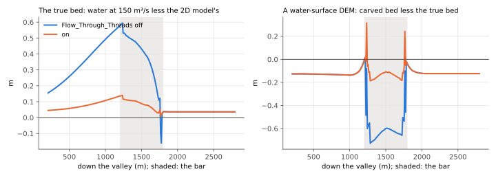

# Flow-Through Threads

ARC's water on a cross section spreads out from the stream cell over a flat water surface until it meets higher
ground: low ground beyond a high point stays dry until the water tops it. Where a bar splits the river, the stream line
follows one thread, and the cross section sees only that one until the water is over the bar, though the river fills
the others from upstream. Below the bar's top, all the flow goes down one thread: its water stands too high, and the
bathymetry carves it too deep to carry it. With `Flow_Through_Threads`, on by default, the river's other threads
carry water too, at the same water surface, and the bathymetry carves them as deep as the channel. It needs a water
mask (`BathyWaterMask`) to find them; without one, nothing changes.

## What a thread is

A thread is a stretch of the water mask along a cross section, apart from the stream cell's own, that joins the river
both upstream and downstream of the cross section. ARC cuts the mask's other stretches along the cross section out of
it, and the cells beside them, and follows the thread's water through the mask: it is a thread if its water still
reaches the river's stream cells, those of its own reach, the reach it flows into and those that flow into it, more
than 60 m up and down the river, and within 3 km of the stream cell either way, across the grid and along it. The
limits are in metres, not cells, so they mean the same on any DEM. Three kinds of water are left out:

- water that joins the river on one side only, as a slough, an oxbow lake open at one end or a backwater does. It
  stands still at the river's level: counted as flowing, it put the water 0.17 m too low past a slough in the tests
  below.
- any stretch with a stream cell on or beside it, which is a stream of its own, or the river itself again where it
  bends back across the cross section. On the FIM benchmark's 85 sites, 10% of the cross sections would otherwise have
  taken the river's own bends as threads; with this, 1.6% have threads, nearly all on rivers with islands.
- water whose lowest ground is more than 2 m above the stream cell's: a terrace's pond, not the river.

A thread's edges are half way between its last water ordinate and the first dry one either side, as the water's-edge
banks are. Its parts within the channel's banks are the channel's own.

## How the hydraulics take it

The water spreads from every vertex of a thread as it does from the stream cell. Each vertex has a connection level,
the lowest water surface at which water reaches it from the stream cell or a thread: the least, over those, of the
highest ground between. A segment holds water where the water surface is above the connection level of either end,
the part of it below the water surface. Without threads that is ARC's rule as it was, bit for bit; a cross section
without threads takes the same code as before. Above a bar's top, the threads change nothing.

The banks the hydraulics divide the cross section at reach out to its outermost threads, so the water in the threads,
and over the bars between them once they're under, is the channel's, not the overbanks'. The threads take the water's
Manning's n; the bars keep their own. With `Valley_Sections`, the overbanks' lines start beyond the outermost
threads.

With bathymetry, each thread is carved as a trapezoid between its water's edges, as deep below the reference level as
the channel, its sides taking `Bathy_Trap_H` of its width, and only ever lowering the ground: its banks are the bars
and the ground beside it. The channel's depth is the one at which the channel and the threads together carry the
baseflow at the reference level.

## Tests against a 2D model

A straight valley of 10 m cells falling 0.001, n 0.035, holds a channel 160 m wide and 3 m deep. A bar 600 m long and
up to 40 m wide, its top 2 m above the bed, splits it into two threads, and the stream line follows the left one. The
2D model (`testing/shallow_water.py`, local inertial) gives the water at each flow; the water mask is its water at
50 m³/s. ARC runs with the standard step.

On the true bed, below the bar's top, ARC's water through the bar stood 0.26, 0.40 and 0.34 m too high at 50, 150 and
300 m³/s, and backed up half a kilometre and more above it. With its other thread, 0.07, 0.08 and 0.10 m too high,
about as much as along the plain channel (0.02 to 0.05 m). Over the bar, at 600 m³/s and up, the two are within 7 cm,
the threads' the closer.

On a DEM that shows the water surface at 150 m³/s, as FABDEM does, with the bathymetry carving the channel to carry
150 m³/s at the DEM's water level (`Bathy_Use_Banks` off), the bed through the bar was carved 0.63 m too deep in the
stream line's thread alone. Carving both threads, 0.14 m too deep, as along the plain channel (0.12 to 0.13 m). The
water through the bar at 300 m³/s went from 0.18 m too high to 0.03 m, and at 1200 m³/s from 0.14 m to 0.05 m. The
spikes at the bar's ends are the stream line's cells stepping across to the other thread. One depth for every thread
is a simplification: where the other thread's bed is 0.75 m higher than the stream line's, the stream line's thread
was carved 0.17 m too shallow (0.25 m too deep without threads), though the water was again closer to the 2D model's
at every flow.

A slough open to the channel at one end, and a closed pit on the floodplain, have no threads, and ARC's water past
them is as it was.

## References

Barnes, R., Lehman, C., & Mulla, D. (2014). Priority-flood: An optimal depression-filling and watershed-labeling
algorithm for digital elevation models. *Computers & Geosciences*, 62, 117–127.

Bates, P. D., Horritt, M. S., & Fewtrell, T. J. (2010). A simple inertial formulation of the shallow water equations for
efficient two-dimensional flood inundation modelling. *Journal of Hydrology*, 387(1–2), 33–45.

US Army Corps of Engineers (2024). *HEC-RAS Hydraulic Reference Manual*, Defining Ineffective Flow Areas. Hydrologic
Engineering Center, Davis, CA.
