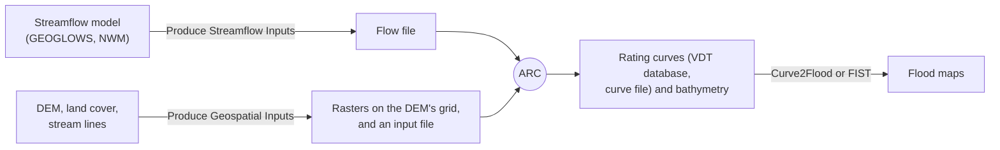

# Automated Rating Curve (ARC)

ARC builds a rating curve for each stream cell of the reaches in its flow file: how the water surface elevation, top
width and velocity change with the flow. It needs a DEM, a stream raster, a land cover raster and a table of flows,
and it applies Manning's equation to a cross section cut across the stream at each cell. Flood mapping tools such as Curve2Flood and
FIST turn the rating curves into flood maps.

For each stream cell, ARC:

1. Measures the stream's slope and direction.
2. Cuts a cross section square to the stream, and if asked (`Degree_Manip`), turns it a little each way to where the
   valley is narrowest.
3. Finds the channel's banks: where the water ends in a water mask or the land cover, or from the DEM.
4. Optionally estimates the channel's bathymetry (the part of the channel the DEM can't see below the water) and
   carves it into the cross section.
5. Works out the water surface elevation, top width and velocity at a series of flows, up to the maximum flow: at
   each cross section's own normal depth, or with `Standard_Step`, linked along the stream (see [Standard Step](standard_step.md)).
6. Writes the outputs you ask for: the VDT database, the curve file, the bathymetry raster, the cross sections and
   others.

## From data to flood maps

The Examples pages walk through each step with a test case. Read the pages in the order of the sidebar: install ARC,
run it, then look up the inputs and outputs as you need them. For a new run, start from the
[recommended settings](model_input_file.md#recommended-settings), and read the [limitations](limitations.md): what
ARC can't do, or does with a known bias, and the one setting that most often goes wrong.

## Authors and acknowledgment
Mike Follum has been the lead for this project since the code was in its AutoRoute days. Other contributors include Ahmad Tavakoly, Alan Snow, Joseph Gutenson, Drew Loney, and Ricky Rosas.

Follum Hydrologic Solutions, LLC (FHS) has open-sourced the ARC and Curve2Flood tools to support early flood warning and preparedness in riverine areas lacking adequate flood data or alert systems. These are first-order tools, designed to encourage the development of more advanced modeling systems. We are grateful to all who share in this mission.

The owners of FHS also believe that those with the ability to help others have a responsibility to do so. This belief is rooted in our faith and supported by the following scriptures:

**Hebrews 13:16** - But to do good and to communicate forget not: for with such sacrifices God is well pleased.

**1 Timothy 6:18** - That they do good, that they be rich in good works, ready to distribute, willing to communicate.

**James 4:17** - Therefore to him that knoweth to do good, and doeth it not, to him it is sin.

**Galatians 6:10** - As we have therefore opportunity, let us do good unto all men, especially unto them who are of the household of faith.
