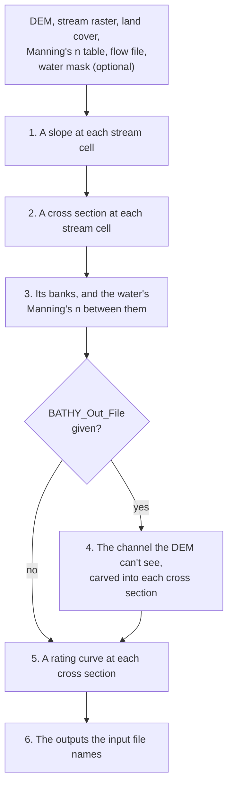
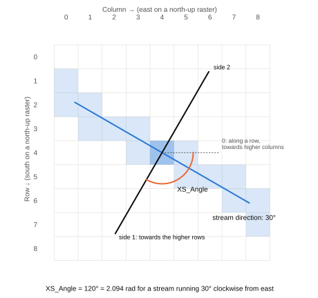

# Key Concepts

## ARC, step by step

1. **Slopes.** Each stream cell's slope, by `Stream_Slope_Method`. A reach whose slope the DEM can't give takes
   its neighbours' (see [Stream Slope Methods](stream_slope_methods.md)).
2. **Cross sections.** The stream cells ARC works on (those of the flow file's reaches that have a slope) become water
   in the land cover (and in the water mask), and each cell takes its land cover's Manning's n. At each of them, ARC
   fits a line to the cells of its own reach within `Gen_Dir_Dist` cells of it to get the stream's direction, and cuts
   a cross section square to it, as long as it needs: out to where the water at its highest flow ends on both sides,
   taking more where a later step needs it, as far as the raster's edge. With `Low_Spot_Range`, it moves the cross
   section to lower ground beside the stream cell, if there is some. With `Degree_Manip`, it turns the cross section
   a little each way and keeps the direction where the water 5 m above the stream is narrowest, since a cross section
   square to the valley crosses it by the shortest way. With `Valley_Sections`, once the bathymetry has settled its
   banks (step 4), each overbank is a line out from its bank square to the valley instead (see
   [Valley Cross Sections](valley_sections.md)).
3. **Banks.** ARC finds each cross section's banks: where the water mask's water ends, if there is one, and
   otherwise from the land cover or the DEM (see [Bathymetry](bathymetry.md#1-find-the-banks)). The channel
   between them takes the water's Manning's n.
4. **Bathymetry** (optional). ARC estimates the channel below the DEM's water surface and carves it into the cross
   sections (see [Bathymetry](bathymetry.md)).
5. **Rating curves.** For each cross section, the water surface elevation, top width and velocity at a series of flows
   up to the maximum flow (see [Outputs](outputs.md#how-a-rating-curve-is-made)): at its own normal depth, or with
   `Standard_Step`, linked to the cross sections around it (see
   [Standard Step](standard_step.md)).
6. **Outputs.** ARC writes the outputs the input file names (see [Outputs](outputs.md)).

## Hydraulics

ARC uses Manning's equation in SI units. The water spreads out from the stream cell on both sides until it meets
higher ground, so low ground beyond a ridge stays dry until the water rises over the ridge. The edge of the raster,
and DEM cells without data, act as walls. A cross section reaches as far as its water needs, so its ends are walls
only at the raster's edge, or at the ends of a manual cross section.

Each cross section is split at its banks into the channel and the two overbanks, and its discharge is the sum of
theirs. With `Valley_Sections`, the overbanks are the lines square to the valley, and carry their water at the
valley's slope. Each part's Manning's n is a composite of the n of the ground under its water, which with
`Depth_Varying_N` (off by default) is higher in shallow water than in deep water. A carved channel is used at its exact
shape, even when it is narrower than a cell.

## Rasters

- The DEM, stream and land cover rasters, and the water mask, must have the same rows and columns, be north-up or
  south-up (not rotated), and have coordinates in metres or degrees. In degrees, ARC works out the cells' size in metres.
- DEM cells without data act as walls. Stream raster cells at or below 0, or without data, aren't stream.
- The land cover is read as whole numbers from 0 to 255. The water mask's water is any value but 0 or no data.
- The bathymetry raster is written as 32-bit floats, and the flood raster as 8-bit whole numbers.

## Directions and sides

ARC uses one convention for directions everywhere, including the `XS_Angle` of its outputs and of manual cross
sections. Directions are measured on the raster's grid, as you see it with row 0 at the top:

- A direction is an angle in radians from the direction of increasing columns (east), turning towards increasing
  rows. On a north-up raster, 0 points east and π/2 south, so angles turn clockwise from east. On a south-up raster,
  π/2 points north.
- A stream's direction runs from 0 up to π (the angle search can turn it a little past either end). It's the line the
  stream follows, and doesn't say which way the water flows along it.
- `XS_Angle` is the direction of the cross section itself, from 0 up to π, a quarter turn from the stream's, towards
  the higher rows.
- In the cross-section file, side 1 is the half of the cross section towards the higher rows, in the direction of
  `XS_Angle`, and side 2 the other half.

The inputs `Degree_Manip` and `Degree_Interval` are in degrees.
