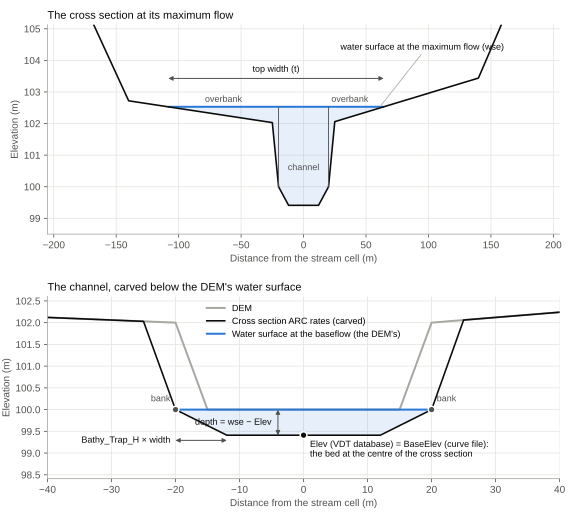
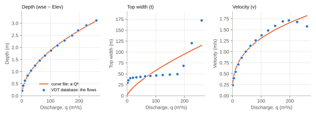

# Outputs

ARC writes only the outputs the input file names. Tables are CSV files (the cross-section file tab-separated text), or
Parquet files when the path ends in `.parquet` (smaller, and faster to read). Rasters are GeoTIFFs on the DEM's grid,
compressed as `Compression` says.

The VDT database, the curve file and the AP database have a row for each stream cell with a complete rating curve, and
the cross-section file one for each cross section ARC used, which these columns identify:

| Column | Description |
| --- | --- |
| `COMID` | The reach ID, or a manual cross section's ID. |
| `Row`, `Col` | The DEM row and column at the centre of the cross section: the stream cell, or the lower cell beside it that `Low_Spot_Range` moved the cross section to. |

## How a rating curve is made

For each stream cell, ARC finds the lowest water surface at which the cross section carries the maximum flow
(`Flow_File_QMax`) by Manning's equation. It then splits the depth from the bed at the centre of the cross section up
to that water surface into `VDT_Database_NumIterations` equal steps, and at each one works out the discharge,
velocity, top width and water surface elevation. The discharge never falls from one step to the next.

The bed is the elevation the rating curve starts from: the carved channel's bed with bathymetry, and otherwise the
DEM's. The VDT database calls it `Elev`, and the curve file `BaseElev`. A water surface elevation less it is the depth
of the water.



Where water spills over a bank into lower ground, the discharge jumps, and the cross section can't carry exactly the
maximum flow. A stream cell only gets a rating curve if the discharge at its top is within half of the maximum flow
either way.

With a baseflow (`Flow_File_BF`, above 0.001 m³/s), the first step's discharge is set 0.001 m³/s below the baseflow if
it was at or above it, so that the baseflow lies inside the rating curve, and its velocity to that discharge over its
area. It keeps the top width and water surface of its depth.

The VDT database keeps the steps; the curve file fits power laws to them. For the cross section above:



A power law follows depth and velocity closely, but not a top width that jumps as the water leaves its banks. Where
that matters, use the VDT database.

### Linking the cross sections

Each cross section's rating curve is its own: the water is at normal depth for that cross section's shape and slope,
whatever the cross sections around it are like. With `Standard_Step`, ARC links the cross sections along the stream
network instead, as a one-dimensional hydraulic model such as HEC-RAS does, and where the bathymetry carved a channel
for its baseflow, holds the water at flows up to the baseflow at most at the level it was carved to. See
[Standard Step](standard_step.md) for how it works.

The rating curves change in two ways:

- The flows are the same along each reach: `q_1` is a `VDT_Database_NumIterations`th of its maximum flow, `q_2` two,
  and so on up to the maximum flow, but the first that reaches the baseflow is set just below it, so that the baseflow
  is one of the flows. Read between two flows, its water would otherwise be a line from the held water below it to
  the step's above it.
- The water surface at each flow is the standard step's (held up to the baseflow), and the velocity and top width are
  the cross section's own there.

The water usually stands higher than at normal depth because the
narrowest cross sections hold it up. Take that into account when choosing Manning's n and `slope_adjustment_factor`.

## VDT database

`Print_VDT_Database`: each stream cell's rating curve.

| Column | Description |
| --- | --- |
| `COMID`, `Row`, `Col` | See above. |
| `Elev` | The bed at the centre of the cross section, which the rating curve starts from: the carved bed with bathymetry, and otherwise the DEM's elevation (m). |
| `QBaseflow` | The baseflow from `Flow_File_BF` (m³/s), or 0 without it. |
| `Slope` | The stream's slope at the cell (m/m). |
| `XS_Angle` | The cross section's direction, in radians (see [Directions and sides](miscellaneous.md#directions-and-sides)). |
| `Valley_Slope` | Only with [`Valley_Sections`](valley_sections.md): the slope the overbanks flow at (m/m), `Slope` times the cross section's slope ratio, or `Slope` where the cross section is left as it is. Curve2Flood takes the velocity over the floodplain from it. |
| `q_1`, `q_2`, ... | The discharge at each step (m³/s). |
| `v_1`, `v_2`, ... | The mean velocity, discharge over area (m/s). |
| `t_1`, `t_2`, ... | The top width (m). |
| `wse_1`, `wse_2`, ... | The water surface elevation (m). |
| `QA_Flag` | The cell's quality flags (see [Decision log](#decision-log)), 0 for none. |

Values are rounded to 3 decimals, except `Slope` and `Valley_Slope` (8) and `XS_Angle` (7). The DEM's own elevation at a cell is in the DEM
at `Row` and `Col`.

## Curve file

`Print_Curve_File`: each stream cell's rating curve as power laws, fitted by least squares:

$$
\text{depth} = \text{depth\_a} \, Q^{\text{depth\_b}}, \quad
\text{top width} = \text{tw\_a} \, Q^{\text{tw\_b}}, \quad
\text{velocity} = \text{vel\_a} \, Q^{\text{vel\_b}}
$$

where the depth is the water surface elevation less `BaseElev`.

| Column | Description |
| --- | --- |
| `COMID`, `Row`, `Col` | See above. |
| `BaseElev` | The bed at the centre of the cross section, as `Elev` in the VDT database (m). |
| `QMax` | The reach's maximum flow from the flow file (m³/s). |
| `Slope`, `XS_Angle` | As in the VDT database. |
| `depth_a`, `depth_b`, `tw_a`, `tw_b`, `vel_a`, `vel_b` | The power laws' coefficients and exponents. |
| `QA_Flag` | As in the VDT database (not in the reach-average curve file). |

Cells whose fit fails, or gives a coefficient that isn't positive, are left out. With `Reach_Average_Curve_File`, the
power laws are fitted to all of a reach's rating curves together, and each of its cells gets the reach's, those
without a rating curve of their own too. A reach whose fit fails, or gives a coefficient that isn't positive, is left
out.

## AP database

`Print_AP_Database`: each rating curve's geometry.

| Column | Description |
| --- | --- |
| `COMID`, `Row`, `Col` | See above. |
| `q_1`, `q_2`, ... | The discharge at each step (m³/s). |
| `a_1`, `a_2`, ... | The flow area, discharge over velocity (m²), 0 where the velocity is 0. |
| `p_1`, `p_2`, ... | The wetted perimeter (m). |
| `QA_Flag` | As in the VDT database. |

## Decision log

`Print_Decision_Log`: a row for each stream cell of the reaches in the flow file, with what each step of the run
decided for it, then a row for each cell skipped for want of a slope.

| Column | Description |
| --- | --- |
| `COMID`, `Row`, `Col` | As in the VDT database: `Row` and `Col` are the centre of the cross section. |
| `Stream_Row`, `Stream_Col` | The stream cell, which `Low_Spot_Range` may have moved the cross section from. |
| `Baseflow`, `Max_Flow` | The cell's flows from the flow file (m³/s). |
| `Slope`, `Slope_Source` | The slope (m/m), and where it came from: `cell` (its own), `reach` (its reach's, the cell having none of its own) or `neighbours` (its reach having none, its neighbours' in the stream network). |
| `Bank_Method` | How its banks were found: `width_to_depth_ratio` (the bank tops, with `Bathy_Use_Banks` or without bathymetry), `water_edge` (the DEM's water's edge: with bathymetry and without `Bathy_Use_Banks`, or where no bank tops were found), `land_cover` (the water mask's or the land cover's water's edge, where neither the bank tops nor the DEM's water's edge are found), `target_width` (the width power law, none being found), `single_cell` (one cell wide, none being found) or `none`. ARC before 0.5.0 also wrote `flat_water`, the DEM's water 0.1 m above the stream cell. |
| `Channel_Width` | The width between the banks the hydraulics use (m): the bank tops, also without `Bathy_Use_Banks`, where `Bank_Method` is the carve's `water_edge`. |
| `Bank_Elevation` | The smoothed bank elevation, with bathymetry (m). |
| `Carve`, `Carve_Depth` | How the bathymetry carved the channel, and how deep (m): `baseflow` (the depth that carries `Flow_File_BF`), `depth_law` (the drainage-area depth), `stream_level` (the baseflow at the stream cell's level, see `Bathy_Bankless_Max_Baseflow`) or `none`; empty without bathymetry. |
| `Valley_Section` | Whether its overbanks were taken square to the valley (`Valley_Sections`). |
| `Subcell` | Whether its narrow channel was reconstructed below the cell scale (`Subcell_Channels`). |
| `Rating_Curve` | `rated`, or why not: `no_slope`, `no_cross_section` (its centre had no data), `reach_dropped` (no bank elevation anywhere in its reach, with `Bathy_Use_Banks`), `no_curve` (the discharge at its top is more than half the maximum flow away from it) or `edge` (`Drop_Edge_Sections`). |
| `Step_Held`, `Step_Critical` | With `Standard_Step`, at how many of its flows the water was held at the baseflow level, and at how many it was at critical depth. |
| `QA_Flag`, `QA` | The sum of the flags below that apply, and their names joined by `|`. |

The flags mark cells to look at, not errors: most runs have many of them. The VDT database, the curve file and the AP
database carry each rated cell's `QA_Flag` too.

| Flag | Value | The cell |
| --- | --- | --- |
| `SLOPE_FROM_NEIGHBOURS` | 1 | Its reach had no slope of its own, and took its neighbours' in the stream network. |
| `LOW_SPOT_MOVED` | 2 | Its cross section is centred on lower ground beside the stream cell (`Low_Spot_Range`). |
| `NO_BANKS_FOUND` | 4 | Neither the water mask, the land cover nor the DEM showed its banks: the channel is as wide as the width power law says, or one cell. |
| `NARROW_CHANNEL` | 8 | Its channel is under 10 cells across, where the DEM's cells blur it, and `Subcell_Channels` didn't reconstruct it (see [Limitations](limitations.md#narrow-channels-and-the-dems-cells)). |
| `CARVED_TO_STREAM` | 16 | Without banks of its own, its channel was carved to carry the baseflow at its stream cell's level. |
| `NO_SLOPE` | 32 | It was skipped: neither the DEM nor the stream network gave its reach a slope. |
| `NO_CROSS_SECTION` | 64 | Its centre had no data, so it has no cross section. |
| `REACH_DROPPED` | 128 | Its reach was dropped from the bathymetry and the rating curves for want of a bank elevation. |
| `NO_RATING_CURVE` | 256 | Its cross section gave no rating curve. |
| `EDGE_DROPPED` | 512 | Its rating curve was dropped, its water reaching the raster's edge. |
| `CURVE_SPILLS` | 1024 | Its rating curve's top discharge isn't the maximum flow: its water spills over a bank there. |
| `STEP_HELD` | 2048 | The standard step held its water at its baseflow level at some flow. |
| `STEP_CRITICAL` | 4096 | The standard step put its water at critical depth at some flow (see [Limitations](limitations.md#steep-reaches)). |

To find the cells with a flag, test its bit: in pandas, `log[(log.QA_Flag & 4) > 0]` for `NO_BANKS_FOUND`.

## What made the outputs

Every Parquet output, and the bathymetry raster's tags, hold `arc_version`, the ARC version, and `arc_configs`, the
run's inputs (every key, defaults included) as JSON, so a file says what made it:

```python
import json
import pyarrow.parquet as pq
from arc.config import Configs

metadata = pq.read_metadata("vdt.parquet").metadata
print(metadata[b"arc_version"].decode())
configs = Configs.from_mapping(json.loads(metadata[b"arc_configs"]))  # the run's inputs again
```

CSV files have nowhere to hold them; `Log_File` writes them, and every message of the run at the info level, to a
text file.

## Bathymetry raster

`BATHY_Out_File`: the elevation of the carved channel, at the cells where ARC carved one, and NaN elsewhere (the raster
has no nodata value). The centre cell of each cross section whose carve changed its ground holds its carved bed, the
`Elev` of its rating curve; where two such centres fall on one cell, it gets their mean. Elsewhere, where cross
sections overlap, a cell gets the mean of their elevations, and small gaps between cross sections are filled from the
cells around them. A cross section that wasn't carved (no baseflow and no drainage-area depth) leaves its centre cell
to its neighbours, so there the raster needn't hold its `Elev`, the DEM's. Curve2Flood can burn it into the DEM. See
[Bathymetry](bathymetry.md).

## Cross-section file

`XS_Out_File`: the cross sections ARC used, after any bathymetry was carved in. Each is split at its centre cell into
two halves, which run outwards from the centre cell as far as ARC kept the cross section: at least past the ground
above the highest water it worked out there, and at most to the edge of the raster. Side 1 is the half towards the
higher rows (see [Directions and sides](miscellaneous.md#directions-and-sides)).

| Column | Description |
| --- | --- |
| `COMID`, `Row`, `Col` | See above. |
| `XS1_Profile`, `XS2_Profile` | The elevations along each half (m). |
| `Ordinate_Dist` | The distance between the points (m). |
| `Manning_N_Raster1`, `Manning_N_Raster2` | The Manning's n at each point. |
| `r1`, `c1`, `r2`, `c2` | The DEM row and column of the last point of each half. |

A text file is tab-separated, with the lists printed to 6 decimals. A Parquet file keeps them as lists of numbers,
exactly as ARC used them. With `Valley_Sections`, these are still each cell's own cross sections: the overbanks'
lines square to the valley aren't in the file (see [Valley Cross Sections](valley_sections.md)).

## Representative cross sections

`Representative_Cross_Section_File`, with `Build_Representative_Cross_Section`: one average cross section for each
reach, for routing models that need one channel shape per reach.

ARC raises the water every 0.10 m above each cross section's centre point, up to 25 m, and works out the area, top
width, discharge and velocity at each stage. The velocity is the channel's (between its banks) where it has banks,
and the whole cross section's where not. At each stage, it averages the cross sections whose area, velocity and top
width are all within two standard deviations of the reach's means. A reach stops at the first stage where a cross
section's hydraulics can't be worked out.

The discharge is Manning's at the cross section's own slope, so the water is at normal depth, unless the run has
`Standard_Step` on. Then each cross section with a rating curve carries the flows that curve has: at each of the
curve's water surfaces, the curve's flow, and between them the flow linear in the water surface, as the VDT database
is read. Below the lowest water surface and above the top one, it carries Manning's discharge at the friction slope
at that end, the slope at which Manning's equation carries the curve's flow there. So each cross section carries the
VDT database's water, and where the step backs the water up, it carries less at each stage than at normal depth.
Cross sections without a rating curve stay at normal depth. A run that builds only representative cross sections makes
no rating curves, so its cross sections are all at normal depth. A cross section's discharge never falls as the stage
rises: where normal depth's would, as where the water spills onto a flat overbank, the discharge below is held, as the
rating curves hold their last increment.

The representative cross section is built from those averages. Its area and top width are kept from falling as the
stage rises, and its depth at each stage is the one that gives that area with the width growing steadily from the
stage below. It is symmetric about the reach's mean bed elevation.

There's a row for each reach and each stage at which some of its cross sections were averaged:

| Column | Description |
| --- | --- |
| `COMID` | The reach ID. |
| `Cross_Section_Count` | How many cross sections the reach has. |
| `Hydraulic_Sample_Count` | How many were averaged at this stage. |
| `Depth_Stage_Index`, `Depth_Stage_Meters` | The stage, 1 for 0.10 m above the bed, and its height (m). |
| `Stream_Slope` | The mean of the cross sections' slopes. |
| `Reach_Inflect_Terrace_Depth` | The reach's highest stage (m). |
| `Representative_Thalweg_Elevation` | The mean of the cross sections' bed elevations (m). |
| `Mean_Discharge`, `Mean_Velocity`, `Mean_Top_Width`, `Mean_Cross_Sectional_Area`, `Mean_WSE` | The averages at this stage. |
| `Mean_Depth` | The stage's height, as `Depth_Stage_Meters`. |
| `Representative_Velocity` | As `Mean_Velocity`. |
| `Representative_Cross_Sectional_Area`, `Representative_Top_Width` | The representative cross section's area and top width at this stage. |
| `Representative_Depth_Increment`, `Representative_Depth` | Its depth gained since the stage below, and its depth (m). |
| `Representative_Stage_Elevation` | Its water surface elevation: the mean bed elevation plus its depth (m). |
| `Representative_Left_Station`, `Representative_Right_Station` | Its water's edges, at minus and plus half its top width (m). |
| `Mean_Friction_Slope` | The mean friction slope of the cross sections averaged at this stage, the slope at which each carries its discharge. Each one's own slope where it is at normal depth; with `Standard_Step`, below the slope where the water is backed up; above it where a falling discharge is held. A routing model that applies Manning's equation to the representative cross section can use it in place of `Stream_Slope`. |
| `Mean_Section_Velocity` | The mean of the cross sections' whole-section velocities, discharge over area: the VDT database's velocity. `Mean_Velocity` is the channel's where a cross section has banks, and differs once water is on the overbanks. |
