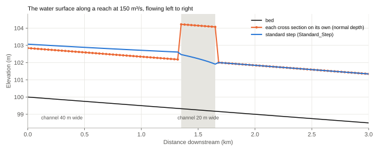
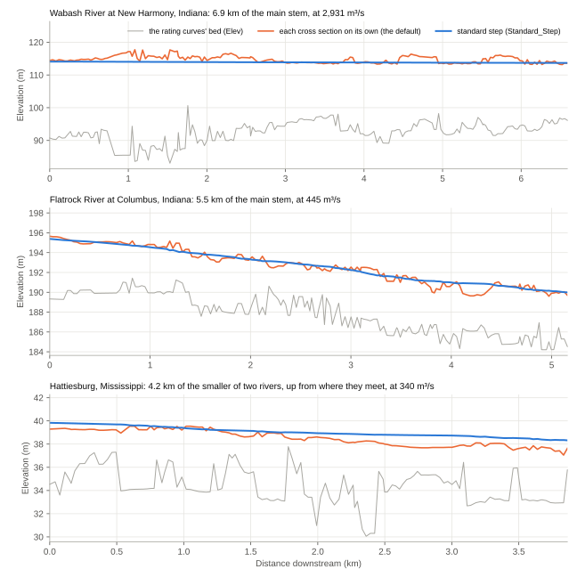
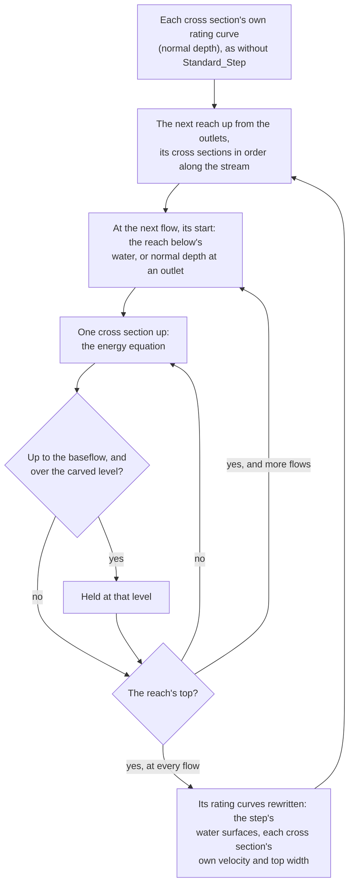
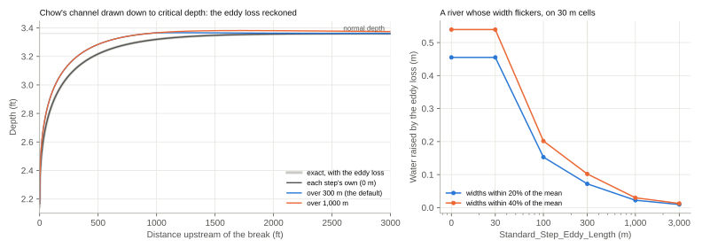
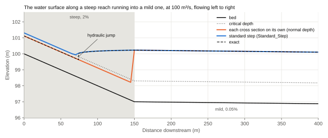
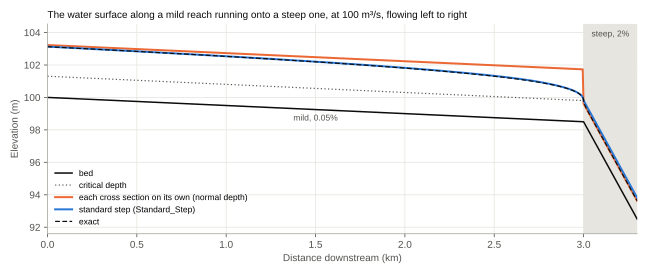
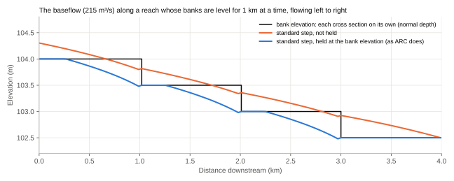

# Standard Step

Without `Standard_Step`, each cross section's rating curve is its own: at each flow, the water stands at normal depth
for that cross section's shape and slope, whatever the cross sections around it are like. With it, ARC links the
cross sections along the stream network by the standard-step method, as a one-dimensional hydraulic model such as
HEC-RAS does (Chow, 1959): working upstream from the network's outlets, it puts each cross section's water where its
energy is what the water below needs, plus what the water loses between them. It is off by default, and needs the
stream network (`StrmShp_File`, with `reach_id` and `downstream_reach_id`). We recommend using it whenever you have a stream network.

## Why link the cross sections

A river's level at a place is set by the channel for some way below it: a narrow stretch backs the water up above it,
and a river backs its water up a tributary. Normal depth knows only its own cross section, so along a reach its water
rises and falls from one cross section to the next as their shapes and beds change, and can even flow uphill.

On their own, the narrow cross sections above each need 4.9 m of water. Linked, the narrow stretch is too short to
reach that depth: it backs the water up for some way upstream instead, and the water falls through it.

On real rivers it looks like this, at the flow of a flood the USGS mapped:

- On the Wabash, each cross section on its own puts the water as much as 4 m above its neighbours', as their shapes
  and beds change from one to the next. Linked, the water falls smoothly, 2 m over the reach, under the peaks: half
  the cross sections on their own put it more than 0.4 m higher, and a tenth more than 2 m higher.
- On the Flatrock, the linked water falls more evenly, and near the end of the reach it stays up over a drop in the
  bed, held there by the reach below.
- At Hattiesburg, the river this one joins backs its water up for all 3.9 km, about 4 m above where each cross
  section on its own would put it (1.6 to 6.2 m at four in five of them). It's all but level: it falls half a metre
  while the bed falls 3 m.

## How it works

### The energy equation

Between a cross section $u$ and the one below it, $d$, $L$ metres apart along the stream, the water's energy, its
surface elevation $z$ plus its velocity head $h$, is the energy of the water below plus what the water loses between
them:

$$z_u + h_u = z_d + h_d + L \bar{S}_f + h_e$$

- The velocity head is $h = \alpha V^2 / 2g$. $\alpha$ is the velocity-head coefficient of the channel and the two
  overbanks, lumped together as one: $\alpha = A^2 \sum_i (K_i^3 / A_i^2) / K^3$. It is 1 where all the water moves at
  one speed, and more where the overbanks' water is slower than the channel's.
- The friction slope is the average conveyance's: $\bar{S}_f = \left(\frac{Q_u + Q_d}{f (K_u + K_d)}\right)^2$,
  with $K$ each cross section's conveyance, $A R^{2/3} / n$ over its channel and overbanks, as its rating curve has
  it (with `Depth_Varying_N` and `Valley_Sections`, as they say), and $f$ the `slope_adjustment_factor`.
- The eddy loss $h_e$ is a share of the change in velocity head going downstream: 0.1 where the water speeds up (a
  contraction) and 0.3 where it slows (an expansion), HEC-RAS's coefficients for gradual transitions (Brunner, 2016),
  reckoned as [The eddy loss](#the-eddy-loss) says.

The cross sections' own slopes aren't in it. The water falls as fast as its friction asks, over the beds the cross
sections have.

### The water at each step

1. **The order.** The reaches are worked out from the network's outlets upstream, each after every reach below it.
   Each reach's cross sections are put in order along the stream: by the reaches next to it in the network, by where
   those lie on the stream raster if they have no rating curves, or else by where the reach's line in `StrmShp_File`
   ends (stream lines run downstream). Only a reach with none of these is turned to put its higher end upstream, by
   the DEM along it, which on flat water can be the wrong way round. The lengths between cross sections are along the
   stream (see [Stream Slope Methods](stream_slope_methods.md)).
2. **The flows.** A cross section's flows are 1/N, 2/N and so on up to its maximum flow (`Flow_File_QMax`), N being
   `VDT_Database_NumIterations`, but the first at or above its baseflow (`Flow_File_BF`) is set 0.001 m³/s below it,
   so that the baseflow is one of the flows (see [The baseflow as one of the flows](#the-baseflow-as-one-of-the-flows)).
   The flow file gives a reach one maximum flow and one baseflow, so the flows are the same all along it.
3. **The start.** An outlet starts from its last cross section's normal depth, or from the water `Outlet_WSE_File`
   gives for it. A reach flowing into another starts from the water at the first cross section of the reach below, at
   the same share of that reach's maximum flow. Where the reaches below have no rating curves (one in a lake, or one
   the flow file leaves out), the reach starts as an outlet does, but no higher than the water at the top of the first
   reach further down that has them, risen by the reach's median slope over the straight distance between them:
   normal depth at one cross section, a choke as like as not on flat water, could otherwise stand the whole reach
   metres above the river below it. Every start is at least critical depth.
4. **Each step up.** The water surface is the lowest at which the energy is enough, at or above critical depth, and at
   or above the cross section's own water at the flow before, so that a cross section's water never falls as the flow
   rises. Where the energy balances at more than one level, as it can where water spreads onto a floodplain, the
   lowest root can otherwise drop as the flow rises. Where no water surface balances the energy, as where the water below is
   supercritical, or the cross section needs more energy than the water below has even at critical depth, the water
   is at critical depth.
5. **The hold.** At the flows up to its baseflow, a cross section whose channel the bathymetry carved for its
   baseflow has its water held at most at the level it was carved to (see
   [Keeping the baseflow in its banks](#keeping-the-baseflow-in-its-banks)).
6. **The rating curves.** The water surface at each flow is the step's, and the velocity, top width and wetted
   perimeter are the cross section's own at that water surface.

### Finding each water surface

Each cross section has a table of 240 water surfaces, from just above its bed to above the top of its own
normal-depth rating curve (by a metre for each two metres of depth, and at least three metres), and its area,
conveyance and velocity-head coefficient at each. The table gives the critical depth, an outlet's normal depth where
the exact search finds none, and the two water surfaces either side of each step's. The water surface between them is
then found with the exact hydraulics, by the Illinois variant of the false position method, to 10⁻⁶ m, so that no
interpolation error builds up from one step to the next. Where the water below stands higher than the table reaches,
as where a deep river backs water up a small one, the search goes on above it. Where the march takes a cross
section's water above where the cross section reaches, it is extended from the rasters and the reach marched again,
so that the results are the same as on cross sections sampled out to the raster's edge.

Where the water tops a high point of a cross section, the low ground beyond joins it at once (see
[Hydraulics](miscellaneous.md#hydraulics)): the cross section's area and top width jump, and its velocity head and
conveyance with them. A wide flat just below the high point, joining an overbank already wet, can raise the velocity
head by a quarter and lower the conveyance, as the overbank's hydraulic radius falls. The energy then jumps across
what the water below needs, and over a range of water below the step puts the water at the high point's level: ARC
takes it on the side with energy enough, so that the step above always gets the same hydraulics from it.

### The eddy loss

The eddy loss is reckoned on the change in velocity head over the next 300 m downstream
(`Standard_Step_Eddy_Length`), not from each cross section to the next: a cross section $n$ cross sections above the
first that far below it takes $1/n$ of the change between them. Cross sections a cell apart differ from their
neighbours a little all the time, and charging every one of those differences, as HEC-RAS does with cross sections
hundreds of metres apart, added up to metres of extra water on a big river. A longer window evens out more of those
differences, but spreads a real change in velocity head, as where the water draws down to critical depth above a steep
reach, over the window above it, raising the water there. On a river on 30 m cells whose width varies by a fifth from
cell to cell, the eddy loss raises the water 0.07 m with 300 m, 0.02 m with 1 km, and 0.46 m charged step by step. On
Chow's channel drawn down to critical depth, either window puts the water up to 0.03 m above the exact profile near
the drawdown; further up, 300 m leaves it 0.002 m above normal depth, and 1 km 0.006 m.

Where the water speeds up going downstream, the contraction loss is reckoned at the velocity head the water would have
without it, and the water raised from there to make it up. Reckoned at the water's own velocity head, the loss grows
faster than the water's energy as it rises near critical depth (above a Froude number of about 0.95, charged step by
step), and the energy then balances only far above where it would without the loss.

## Where the slope changes

A slope is mild where its normal depth is above critical depth, so that its water is subcritical, and steep where its
normal depth is below it, so that its water is supercritical: it runs faster than a wave can travel up it, and what
lies below can't reach it. The standard step marches upstream, as subcritical water is set by what lies below it, and
finds subcritical water only. Both figures below are the same trapezoidal channel, 20 m wide at the bed, at
100 m³/s: its critical depth is 1.31 m, its normal depth 3.23 m on the mild slope, 0.0005, and 1.12 m on the steep
one, 0.02. The cross sections are 5 m apart, each the trapezoid exactly, and the exact water surface is the gradually
varied flow equation's (Chow, 1959), without the eddy loss.

### A steep reach running into a mild one

The water comes down the steep reach at its supercritical normal depth until the mild reach's water backs up to meet
it. There it jumps up to the depth whose momentum and pressure (its specific force) are the same, 1.51 m, 76 m above
the break, and rises from there to the mild reach's normal depth at the break, nearly level (an S1 profile). The
standard step, marching up from the mild reach, follows that backwater to within 0.015 m. Above it, no subcritical
water surface balances the energy, so the step puts the water at critical depth, 0.19 m above the exact water. The
step's water rises from critical depth to the backwater where the backwater falls to critical depth, 80 m above the
break, 4 m above the exact jump. Each cross section on its own is right on the steep reach above the jump, but misses
the backwater: just above the break it is 2.0 m too low.

Were the mild reach's normal depth below the jump's depth, 1.51 m, the jump would stand on the mild reach instead,
the supercritical water running on to it and deepening (an M3 profile). The step would still put the water at
critical depth on the steep reach, and at the mild reach's subcritical water below the break: above the exact water
as far as the jump.

### A mild reach running onto a steep one

Here the water passes through critical depth at the break. Above it, the water draws down to critical depth from the
mild reach's normal depth (an M2 profile), and is back up 95% of the way to normal depth 3.1 km above the break. Below
it, the water falls on to the steep reach's normal depth within 21 m (an S2 profile). The step starts from critical
depth at the outlet (every start is at least critical depth) and keeps the water there down the steep reach, 0.19 m
above its normal depth. From the break up, it draws the water down as the exact profile does: within 0.02 m in the
200 m above the break, and 0.03 m further up, from the eddy loss as the water speeds up towards the break (see
[The eddy loss](#the-eddy-loss)). Each cross section on its own stays at normal depth right to the break, 1.7 m too
high just above it.

So the step finds the water wherever it is subcritical. Where it is supercritical, the step puts it at critical
depth, as HEC-RAS does in its subcritical regime. That is higher than the supercritical water, by 0.19 m here, so the
error is on the side of a wider flood.

## Keeping the baseflow in its banks

### Why the step lifts it

With bathymetry (`BATHY_Out_File`), ARC carves each channel so that its baseflow fills it at normal depth exactly to a
level: its bank elevation with `Bathy_Use_Banks`, and otherwise its stream cell's elevation, the DEM's water surface
(see [Water surface or banks](bathymetry.md#water-surface-or-banks)). Each cross section on its own then puts its
baseflow at that level. Linked, the water needn't stay there. A channel full to its banks loses energy to friction at
the slope it was carved for, its cell's slope. Where its banks fall more gently than that, the water's surface falls
faster than they do, so going upstream it rises over them.

ARC's bank elevations often do fall more gently. A bank elevation is the stream's elevation, made never to rise
downstream, plus a bank height (see [Smooth the banks](bathymetry.md#2-smooth-the-banks-along-each-reach)): it is level
wherever the stream rises again after a low point, and then drops in a step, while each channel is still carved for
its cell's slope. And where a bank
rises going downstream, as where a reach's end is ramped up to meet a higher reach at a junction, or where the banks' height rises along it, the bed rises with it, and holds the water up behind it as a weir does.

Each cross section in the figure is a channel 30 m wide at the bed and 4 m deep, which its baseflow, 215 m³/s, fills
to its banks at the stream's slope, 0.0005, as a channel the bathymetry carved for it does. Its banks are level for a
kilometre, then drop 0.5 m, and its bed with them. Not held, the baseflow rises over the level banks going upstream, up
to 0.42 m over them at the top of each kilometre. Held, it stays at the banks, and just above each drop it draws down
towards it, as water does above a fall.

### The hold

So at every flow up to its baseflow, a cross section whose channel's depth came from its baseflow has its water held at
most at that level. Where the step would put the water higher, it is lowered to the level, the energy above it taken
as lost there, as over a riffle, and the march goes on upstream from the held water. A steep cross section is held
there too where its critical depth is higher: supercritical water stands below critical depth. Above the baseflow, the
water is the step's own.

Only the channels the bathymetry carved for the baseflow hold their water. Without `BATHY_Out_File`, nothing is held;
nor is a cross section whose depth came from the drainage-area depth law (`coefficient_depth`, `exponent_depth`), or one
the carve left as it was (no baseflow, or a channel already deep enough), since nothing says its baseflow fills it to a
level.

### The baseflow as one of the flows

The hold works on the flows the step works out. If the baseflow fell between two of them, Curve2Flood would read its
water as a line from the held water at the flow below it to the step's water at the flow above, over the banks. So the
first flow at or above the baseflow is set 0.001 m³/s below it, and the baseflow's water is the held water. 

### Why a hold, and not other banks

Banks that never rise across junctions let one low reach hold the whole main stem below it down. The hold leaves the 
banks and beds as the bathymetry makes them, and changes only the water at the flows up to the baseflow.

## Limits

- **Subcritical only.** A reach too steep for subcritical flow gets critical depth, not its supercritical depth: on
  Chow's steep reach, 2.15 ft rather than 2.0 ft (see [Running the Tests](testing_unit_tests.md#chows-channel)). In a
  wide channel critical depth is Fr2/3 times the supercritical depth, 1.6 times at a Froude number of 2, so
  in steep reaches the water can stand well above the real water. Such cells carry the `STEP_CRITICAL` flag (see
  [Limitations](limitations.md#steep-reaches)).
  Below a fall, the water is at critical depth as far as the tailwater's energy can't reach, and then the tailwater's,
  with no jump between, as in HEC-RAS's subcritical regime (see [Where the slope changes](#where-the-slope-changes)).
- **Cross sections only.** There are no bridges, culverts, weirs or junction losses: the ground the DEM shows is all
  there is, and a reach joins the reach below at its water.
- **One flow a reach.** Each reach carries its own flows all along it, with no inflow between its ends. Each starts
  from the water of the reach below at the same share of that reach's maximum flow, so at a junction the two are the
  same flood if the flow file's maximum flows are.
- **The DEM's cells.** The step itself doesn't depend on how far apart the cross sections are: on a synthetic channel
  narrowing from a 60 m bed to 30 m for 150 m, its backwater peaked 3.375 m deep with exact cross sections 1 m apart,
  and 3.358 m with them 30 m apart. On DEMs of the channel, ARC's peak was 0.07 m too high on 5 m cells, 0.30 m on
  10 m, 1.05 m on 20 m and 1.91 m on 30 m. A cell averages the ground under it, and straight lines between the cells'
  centres turn the channel's corners into ramps, so the narrow cross sections, which hold the water up, have too
  little area. Normal depth is as far out, on its own. Where the backwater matters, the narrowest channel's bed
  should be about six cells across or more, or `Subcell_Channels` can reconstruct it (see
  [Limitations](limitations.md#narrow-channels-and-the-dems-cells)).

## Settings

| Key | Default | What it does |
| --- | --- | --- |
| `Standard_Step` | False | Links the water surfaces along the stream network. Needs `StrmShp_File` with `reach_id` and `downstream_reach_id`. |
| `Standard_Step_Eddy_Length` | 300 | How far downstream, in metres, each step's eddy loss is reckoned over (see [The eddy loss](#the-eddy-loss)). 0 charges each step the change in velocity head from the cross section below. |
| `Outlet_WSE_File` | None | The water surface to start reaches that leave the raster from, instead of normal depth (see [Model Input File](model_input_file.md)). Needs `Standard_Step`. |
| `VDT_Database_NumIterations` | 15 | How many flows, the shares of each maximum flow the step works out. |
| `Flow_File_BF` | None | The baseflow: one of the flows, and with bathymetry, the flow up to which the water is held (see [Keeping the baseflow in its banks](#keeping-the-baseflow-in-its-banks)). |
| `Bathy_Smooth_Bed` | False with `Standard_Step` or `Bathy_Use_Banks` | Whether to smooth each reach's channel bed. Off, each channel carries its baseflow at its own banks. |

## Tests

`testing/test_standard_step.py` checks the step on its own and in a run of ARC on a synthetic channel: its table's
normal and critical depths, that uniform flow steps up at normal depth, that deeper water below backs up and fades
upstream, critical depth where the water below is too low, the side with energy enough at a high point, the eddy
loss's window, the flows and the baseflow among them, a reach below backing its water up the reach above, the order of
a reach whose neighbours have no flows, the cap on a reach above one without flows, the hold, that nothing is held
without bathymetry, and that the step is off by default and needs the stream network.

`testing/test_benchmarks.py` runs it on HEC-RAS's verification tests whose answers are exact: Chow's channel, flow over
a bump and MacDonald's variable sloping bed (see [Running the Tests](testing_unit_tests.md#textbook-hydraulics)).

## References

Brunner, G. W. (2016). HEC-RAS River Analysis System Hydraulic Reference Manual, Version 5.0 (CPD-69). US Army Corps
of Engineers, Hydrologic Engineering Center.

Chow, V. T. (1959). Open-Channel Hydraulics. McGraw-Hill.

US Army Corps of Engineers, Hydrologic Engineering Center (2018). HEC-RAS Verification and Validation Tests (RD-52).
https://www.hec.usace.army.mil/software/hec-ras/documentation/RD-52_HEC-RAS%20Verification%20and%20Validation.pdf
