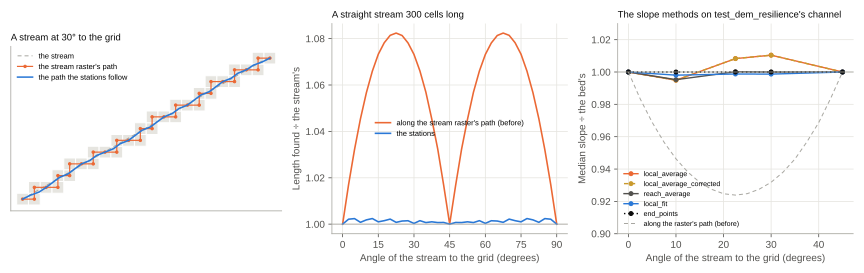
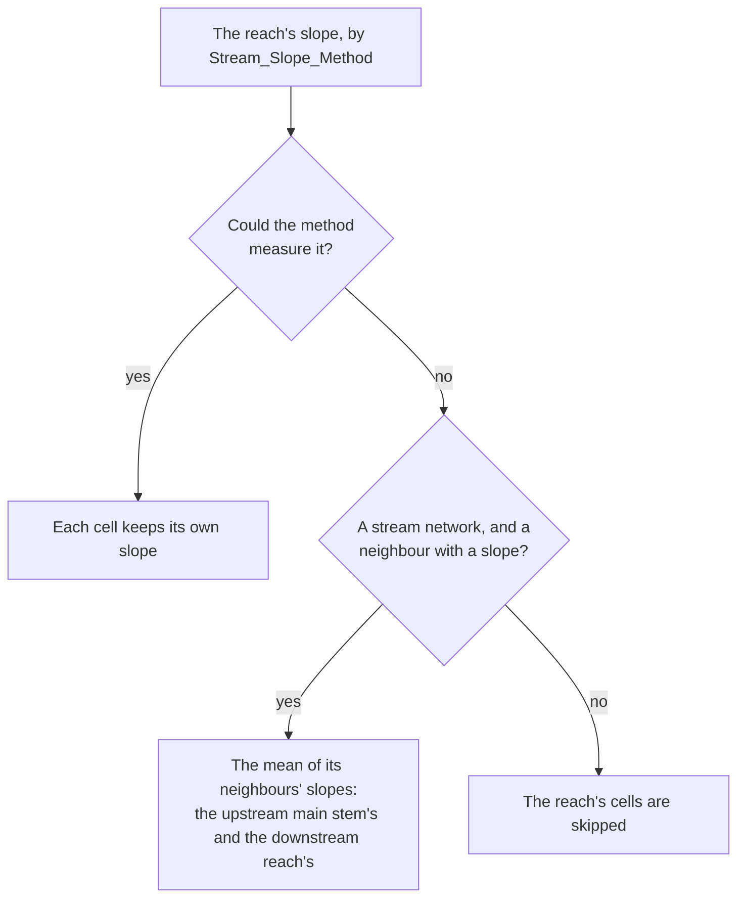

# Stream Slope Methods

Manning's equation needs the slope of the stream at each cell. ARC measures it from the DEM along the stream raster,
as the drop between two stream cells over the distance between them along the stream. `Stream_Slope_Method` picks
one of five methods (see [Distances along the stream](#distances-along-the-stream) for how far apart two cells are):

| Method | Each cell's slope |
| --- | --- |
| `local_average` | The mean of the slopes from the cell to the other cells of its reach within `Gen_Slope_Dist` cells of it, kept between 0.00001 and 0.5. |
| `local_average_corrected` (default) | The local average, kept between two percentiles of the slopes between pairs of the reach's cells (`Slope_Low_Percentile` and `Slope_High_Percentile`, 5 and 95 by default). This narrows the spread of slopes along a reach. |
| `reach_average` | The reach's median slope, from the slopes between all pairs of its cells within `Gen_Slope_Dist` cells of each other (leaving out level pairs), between the same two percentiles. Every cell of a reach gets the same slope. |
| `end_points` | The drop between the two ends of the reach's line in `StrmShp_File` over its length, at least 0.00001. Every cell of a reach gets the same slope. The reach's line is the first whose field named as `Flow_File_ID` is (as `reach_id` is, in a run that builds only representative cross sections) holds the reach's ID. |
| `local_fit` | The fall of the straight line fitted by least squares to the elevations of the `2 × Gen_Slope_Dist + 1` cells nearest the cell along the stream (as many near the reach's ends, more on one side), against their distance along the stream, kept between 0.00001 and 0.5. A rise between cells offsets a fall, where the methods above count both as falls. Which way is downhill is the way the line through the whole reach falls, and that line's fall is the reach's slope. The percentiles aren't used. |

A reach with the same slope all along has both percentiles equal, and keeps that slope.

With a stream network, the local averages (`local_average` and `local_average_corrected`) also count the cells of the
reach's neighbours on its main stem: the reach below it, and the reach above it with the most reaches above that.
Averaged over its own reach alone, a cell near a junction would see one side of it only, and the slopes would jump
from one reach to the next. The percentiles, and the reach's median slope, are still from the reach's own cells.

!!! note "The percentiles aren't an outlier filter"
    They are percentiles of the slopes between pairs of cells, which spread more widely than the local averages they
    bound. So a low percentile below about 20 seldom raises any cell, and runs of steep cells sit inside the reach's
    own upper percentiles, where no setting catches them without changing most other cells too. Raising both
    percentiles makes slopes steeper and more alike along a reach; to make slopes steeper on purpose, use
    `slope_adjustment_factor`.

## Distances along the stream

A stream raster's cells join their eight neighbours, so a stream at an angle to the grid crosses it in stair steps:
along a row, then across a diagonal. Measured along those steps, a straight stream at 22.5 degrees to the grid is 8%
longer than it is, and its slopes came out that much too gentle (7% at 30 degrees), which put the water at the maximum
flow 4 cm high on a test channel. So the distance along the stream between two cells is measured along the cells' path
with each cell moved towards the mean of the three either side of it along the path, but no more than half a cell
along a row or a column, about as far as a stair step strays from the stream it follows. Straight streams then come out
within 0.3% of their length at any angle, and every method's slope within 1% of the bed's; a meander keeps its length
to within 1% where its crests are 60 cells or more apart, and loses 5% where they are 20 apart. Two cells side by side
across the stream, at the same distance along it, are measured in a straight line. `end_points` measures the stream's
line in `StrmShp_File`.

The same distances order each reach's cross sections for the bank smoothing and space them for the standard step.

## When a slope can't be measured

Sometimes the DEM can't give a reach a slope:

- `local_average`: no cell of the reach has another stream cell within `Gen_Slope_Dist` cells of it, of its own reach
  or, with a stream network, of its main-stem neighbours, as on a reach of one cell without a stream network.
- `local_average_corrected` and `reach_average`: no two cells within `Gen_Slope_Dist` cells of each other have
  different elevations, as on a reach of one cell or a flat stretch, so there are no percentiles.
- `end_points`: the ends of the reach's line can't be read on the DEM, or the reach has no line.
- `local_fit`: the reach has fewer than two cells with elevations.

Whatever the method, such a reach takes the mean of the slopes of its neighbours in the stream network (`StrmShp_File`,
with `reach_id` and `downstream_reach_id`): of the reaches just upstream that have a slope, the one with the most
reaches above it, and the reach downstream, if it has one. This repeats, so a reach can take its slope from a neighbour
that took one itself. A reach that still has no slope, or one without a stream network, is skipped.

Within a reach that has a slope, a cell that has none of its own takes the reach's. A cell has none of its own with
`local_average` or `local_average_corrected` where no other stream cell is within `Gen_Slope_Dist` cells of it, and
with `local_fit` where the DEM has no data. The reach's slope is the median of its cells' local averages with
`local_average`, its median slope between the percentiles with `local_average_corrected`, and the fall of the line
through all its cells with `local_fit`.

## Which method to use

We recommend `local_fit` or the default, `local_average_corrected`, with `Gen_Slope_Dist` of 5 to 10 and the
percentiles at 5 and 95.

- **`local_fit`** gives the DEM's drop best. Over 316 reaches at 68 sites, with `Gen_Slope_Dist` 5, the drop its
  slopes add up to along each reach was 1.00 times the DEM's drop, against 1.28 times with `local_average_corrected`
  (percentiles 1 and 99) and 1.14 with `local_average`. The methods that average the slopes between pairs of cells
  (`local_average`, `local_average_corrected` and `reach_average`) count every rise along the stream as a fall, so a
  noisy DEM makes them steep: 2 cm of noise along a test channel made their slopes two to three times the bed's. A
  line fitted through the cells lets a rise offset a fall.
- **`local_average_corrected`** is the default, and the flood maps don't tell the two apart: on the 68 sites where
  the USGS mapped real floods, `local_fit` lowered the flood maps' mean MCC (Matthews correlation coefficient) by
  0.005 with `Standard_Step` and raised it by 0.007 without, both within the noise between sites.
- **The percentiles.** 5 and 95, the defaults, trim only the extremes. At 25 and 75 (the defaults before 2026-10-25),
  a reach's slopes are capped at its upper quartile of the slopes between pairs of cells. With `Standard_Step`, any
  upper percentile of 75 or less lowered the flood maps' mean MCC by about 0.006, while 0 and 100, 1 and 99, 5 and 95
  or 10 and 90 all scored within 0.001 of each other. Don't tune them
  as a slope knob: they act mostly through the bathymetry's depth. To make slopes steeper or gentler on purpose, use
  `slope_adjustment_factor`.
- **`Gen_Slope_Dist`.** 30 and 100 cells scored 0.001 and 0.002 lower than 5.
- **`reach_average`** gives every cell of a reach one slope, the median of its pairs', which came out 0.86 times the
  DEM's drop. **`end_points`** gets each reach's drop exactly, but from two points only, so a reach's slope can be far
  from its local slope, and it lowered the flood maps' mean MCC by 0.005.
