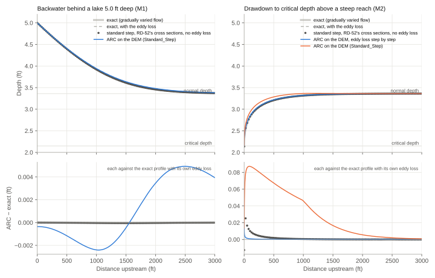
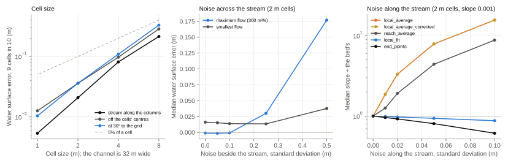

# Running the Tests

ARC's tests are in the `testing` folder and run with [pytest](https://docs.pytest.org/). Install it in ARC's
environment, along with matplotlib for the plots of the end-to-end tests:

```bash
conda install -c conda-forge pytest matplotlib
```

Run the unit tests, which take about a minute:

```bash
pytest testing
```

The end-to-end tests (`testing/unit_test_with_*.py`) build synthetic channels, with known shapes, slopes and angles,
run ARC on them, and check its results: the shapes and angles against Manning's equation, the slope methods for
complete, finite rating curves, and the representative cross sections' table. They take a few minutes, and run only
when named:

```bash
pytest testing/unit_test_with_*.py
```

Each of them can also run as a script, which writes its inputs and outputs to a folder in `testing` for you to look
at, prints a summary and shows its plots:

```bash
python testing/unit_test_with_shapes.py
```

GitHub runs both sets of tests on every pull request, on Linux and Windows.

## A real site

`testing/data/sweetwater_creek` holds ARC's inputs for Sweetwater Creek near Austell, Georgia, one of the sites where
the USGS mapped a real flood, clipped to the nine reaches of its flow file (379 by 295 cells of a 30 m DEM, about
400 KB). Its `README.md` gives the data's sources and licences: the DEM is FABDEM, which isn't for commercial use.
`testing/test_pipeline.py` runs ARC on it with and without the standard step and checks that every rating curve is
Manning's discharge on its own cross section and rises with the water, and `testing/test_decisions.py` checks the
decision log, the quality flags, the log file and the outputs' metadata on it. A run takes a couple of seconds, so these
run everywhere, CI included. The tests also run on two more FIM sites where their data are on the machine, and skip
them elsewhere.

## Benchmarks

Five files of the unit tests check ARC against known answers: textbook channels, a river whose channel is known, DEMs
of one channel at different cell sizes, alignments and noise, channels whose banks are known, and a 2D model of a
meandering valley. A sixth checks the 2D model. Where the answer is the normal depth of a known shape (the DEMs' true
channel, and the level a carved channel carries its flow at), it comes from ARC's own normal-depth solver on that
shape, which the textbook channels check. They run with the unit tests, in under a minute.
`docs/figures/make_test_figures.py` draws the figures below from the same synthetic rivers.

### Textbook hydraulics

`testing/test_benchmarks.py` runs the steady-flow tests of HEC-RAS's verification report (USACE, 2018, RD-52) whose
answers are exact: Chow's channel (test 2.2.1), flow over a bump without friction (2.2.2), and subcritical flow over a
variable sloping bed (4.2.2, which RD-52 runs on its 2D model). RD-52's other steady-flow tests are a drop structure
in a flume and a bridge, against measurements.

#### Chow's channel

Chow's (1959) trapezoidal channel is the first steady-flow test in RD-52. The channel is 20 ft wide at the bed, its
sides slope 2:1, n is 0.025, the bed slope 0.0016 and the flow 400 ft³/s. A lake holds the water 5.0 ft deep at the
downstream end. The reference profiles are the gradually varied flow equation, solved exactly. The standard step's
eddy loss, C times the change in velocity head, makes the velocity-head coefficient 1 − C where the water slows going
downstream and 1 + C where it speeds up, so the same equation gives the reference with the eddy loss too.

| Test | Reference | ARC |
| --- | --- | --- |
| Normal depth | 3.36 ft, at 4.45 ft/s (Chow, 1959) | 3.36 ft, exactly, and on a DEM of the channel |
| Critical depth | 2.15 ft | 2.15 ft, to the spacing of the standard step's table |
| Backwater behind the lake (M1): RD-52's cross sections, 25 ft apart for 3000 ft, without eddy losses, as RD-52 runs it | The exact profile. HEC-RAS came within 0.01 ft of Chow's hand calculation. | Within 0.0001 ft. With the eddy loss, within 0.0001 ft of the exact profile with it. |
| The same on a DEM of the channel, on 1 ft cells (`Standard_Step`) | The exact profile, with the eddy loss | Within 0.01 ft |
| Drawdown to critical depth above a steep reach (M2): RD-52's cross sections | The exact profile, from critical depth at the break | Within 0.03 ft in the 200 ft above the break, and 0.01 ft beyond |
| The same on a DEM of the channel | The exact profile, with the eddy loss | Within 0.005 ft beyond the first 20 ft (0.03 ft in them), with the eddy loss charged step by step (`Standard_Step_Eddy_Length: 0`). Up to 0.1 ft above it as ARC runs by default (see below). |
| A reach too steep for subcritical flow | Its supercritical normal depth, 2.0 ft | Critical depth, 2.15 ft: the standard step is subcritical |



As ARC runs the standard step by default, each step's eddy loss is reckoned over the next 300 m downstream (see
[Standard Step](standard_step.md#the-eddy-loss)), which keeps cross sections a cell apart from adding up each other's
differences. A drawdown's loss is then spread over the 300 m above it: on Chow's channel, the water there stands up to
0.1 ft (3 cm) above the exact profile, and 0.006 ft (2 mm) above normal depth further up, which the exact profile never
reaches. Over 1 km, as it was, the water stood 0.02 ft above normal depth.

#### Flow over a bump without friction

A channel 0.3 m wide, flat but for a bump 0.2 m high between 8 and 12 m, carries 0.054 m³/s with n 0.0001 to a
tailwater 0.33 m deep, on RD-52's cross sections, 0.2 m apart. The water passes through critical depth at the crest,
runs down the bump supercritical, and jumps back up to the tailwater 1.66 m past the crest. The exact water surface is
Bernoulli's equation either side of the crest, with the jump where the specific forces either side of it are equal.
HEC-RAS, in its mixed flow regime, came within 0.01 m of it throughout.

| Test | Reference | ARC |
| --- | --- | --- |
| Upstream of the crest, without eddy losses | Bernoulli's, from critical depth at the crest | Within 0.0003 m |
| The same, with the eddy loss | Bernoulli's with the contraction loss: 0.1 of the gain in velocity head where the water is slow, less towards critical depth | Within 0.0008 m, and 0.006 m above the frictionless profile |
| The crest | Critical depth, 0.149 m | 0.151 m, to the spacing of the standard step's table (0.015 m). The water upstream hardly feels it, as the energy is least there. |
| Down the bump to the jump | Supercritical, then the jump | Critical depth as far as the tailwater's energy can't reach (1.25 m past the crest), then the tailwater's subcritical depth: above the exact water as far as the jump. The standard step is subcritical, as HEC-RAS's subcritical regime is. |
| Below the jump | Bernoulli's, from the tailwater | Within 0.0001 m |

#### Subcritical flow over a variable sloping bed

MacDonald et al. (1997) worked channel beds out backwards from water surfaces chosen for them, so that the answer is
exact. RD-52 runs SWASHES's (Delestre et al., 2013): a reach 1000 m long carrying 2 m³/s per metre of width at n
0.033, its depth rising from just above critical depth at either end to 1.5 times it in the middle, so that the Froude
number falls from 0.99 to 0.54 and rises again. The test puts the same depths in a trapezoid 10 m wide at the bed
carrying 20 m³/s, with its bed worked out for them: it falls 8.1 m, at slopes from 0.0034 to 0.013.

| Test | Reference | ARC |
| --- | --- | --- |
| Cross sections 32 m apart, without eddy losses | The exact depths | Within 0.0008 m (0.0005 m on average). The error falls as the square of the spacing, to 0.00002 m 4 m apart. HEC-RAS's 2D model was within 0.0033 m on average on 32 m cells, and 0.0005 m on 1 m cells. |
| On a DEM of the channel, on 1 m cells, each cross section alone | The exact depths | 0.019 m out on average, up to 0.056 m: each cross section is at normal depth for its own slope |
| The same with `Standard_Step` | The exact depths | 0.0023 m out on average, and within 0.005 m everywhere |

The bed found a weakness, since fixed: **near critical depth, the eddy loss put the step on a second root.**
Reckoned at the water's own velocity head, the contraction loss (0.1 of the gain in velocity head going downstream)
grows with the depth faster than the specific energy does above a Froude number of about 0.95, so the energy
equation's root at normal depth only touched zero, and the step found the next root up: uniform flow at a Froude
number of 0.986 stepped up 0.02 m above normal depth, and on the DEM the last 5 m above the tailwater's reach stood up
to 0.025 m high. The step now reckons the contraction loss at the water surface it gives without it (see
[Standard Step](standard_step.md#the-eddy-loss)), so uniform flow stays at normal depth, with the eddy loss or
without, and in a drawdown the loss is C (1 − Fr²) / (1 − (1 − C) Fr²) of the gain in velocity head, falling to
nothing at critical depth. That is the reference with the eddy loss in the drawdown and bump rows above; reckoned at
the water's own velocity head, it was a velocity-head coefficient of 1.1, whose critical depth is at a Froude number
of 0.95.

### What Bathy_Use_Banks means

`testing/test_bathymetry_modes.py` runs a river whose channel is known, with a DEM showing its water flat at a low
flow, in each mode, with the low flow and with the bankfull flow. In every case `Flow_File_BF` fills the carved
channel exactly to the mode's level at normal depth: the DEM's water surface, or the bank elevation. Each mode given
its own flow carves the true channel, to a millimetre, with a water mask or without: without `Bathy_Use_Banks` the
channel is carved between the DEM's water's edges, and with it below the bank tops; the hydraulics divide at the bank
tops in both. In a canyon whose bench is above the water that carries
the maximum flow, the bench isn't taken for the banks, and in a canyon through a hill on a reach with a floodplain
either side, the canyon takes the floodplain's bank height and width. `testing/test_bank_modes.py` checks each mode's
banks on single cross sections: the water level beside a burned stream cell, masks too narrow, too wide or spilling
onto the floodplain, a valley wall above the maximum flow's water, the edges on the ground below that water, and noise
on the water; and without bathymetry, the bank tops on a DEM that shows the bed, whatever the mask, and the edges of
the maximum flow's water where the channel holds it.
See
[Bathymetry](bathymetry.md#water-surface-or-banks).

### The DEM

`testing/test_dem_resilience.py` puts one channel on DEMs: 20 m wide at the bed, with banks 3 m high and 32 m apart,
and a maximum flow standing 1.07 m over them. Each cell is the mean of the true ground over it, as a DEM resampled
from finer data is. ARC's water surfaces are compared with the true channel's.



- **Cell size.** Coarse cells fill in the channel's corners, so the water stands a little higher, most at low flows.
  It is within 5% of a cell size of the true water surface: 0.21 m at 8 m cells, a quarter of the channel's width,
  and 7 mm at 1 m. That holds whether the stream runs along a row of cells or between them, and for 9 cells in 10
  where it crosses the grid at an angle. Every slope method gives the bed's slope to within 2% at an angle, as the
  stations follow the stream raster's path smoothed (see [Stream Slope Methods](stream_slope_methods.md)); along the
  raster's stair steps, the slopes were up to 8% too gentle.
- **Noise beside the stream**, as a DEM with its streams burned in has, moves the water at the maximum flow by
  centimetres, up to a few tenths of a metre with 25 cm of noise. With every stage tried, the width-to-depth ratio
  found banks far inside the noisy channel, which put the water a tenth of a metre high even with 5 cm of noise.
- **Noise along the stream** changes the slopes (right).

The tests also mark known weaknesses as expected failures (`xfail`). pytest lists them in its summary, and each fails
once it's fixed, as a reminder to drop the mark:

- **Backwater above the maximum flow's water** (`test_benchmarks.py`). Chow's channel, 8 ft deep, holds its maximum
  flow 3.4 ft deep, so its banks are that water's edges, and behind the lake the water backed up above them is divided
  there: up to 0.06 ft low against the exact profile. The standard step itself gives the profile exactly
  (`test_the_standard_step_gives_chow_s_backwater_profile`).

- **Noise along the stream steepens the slopes.** `local_average`, `local_average_corrected` and `reach_average`
  count each rise between stream cells as a fall, so noise only adds to the slope. Noise of 2 cm on 2 m cells, on a
  bed falling 2 mm a cell, makes the slope 2 to 3.3 times the bed's, and the water at the maximum flow lands 0.3 to
  0.5 m too low (a median); 5 cm of noise puts it 1.3 m too low. `local_fit` and `end_points` stay within 10%. A DEM
  whose streams are burned in to fall steadily doesn't have this noise.

### Bank detection

`testing/test_bank_detection.py` checks the bank search on channels whose banks are known:

- **Shapes and spacings.** Trapezoids with steep or gentle sides, wide and shallow ones and a V, on cross sections
  0.5 to 5 m apart: the width-to-depth ratio's banks are within an ordinate's spacing of the bank tops. With one bank
  lower, the water spills over it; a two-stage channel's banks are its inner channel's; a V has none (its ratio never
  rises). A floodplain that rises less than 0.1 m before the cross section ends still ends the search at the banks.
- **The water's edge.** On a DEM showing the water flat, flat water finds the water's edge, and a water mask's banks
  are half way to the first dry ordinate, where the width-to-depth ratio finds the bank tops.
- **Noise.** With 2 cm (5 cm) of noise on the water and the banks, the banks are within a fifth of the bank tops'
  width at 92% (80%) of the cross sections, where trying every stage found them at almost none. With the water flat,
  as DEMs level it, 25 cm of noise on the banks leaves every one there.
- **On a DEM.** A channel 32 m between its bank tops, on cells 2 m and 8 m wide, along the grid and at 30° and 45° to
  it: every cross section's banks within two ordinate spacings of the bank tops.
- **Real rivers.** On the Wabash at New Harmony and the Susquehanna at Harrisburg (`fim_sites_nencarta`, skipped
  where it isn't on the machine), where the width-to-depth ratio and the water mask both find banks, the ratio's are
  inside the mask's water at no more than 3% of the cross sections; trying every stage, at 73% and 72%.

### A meandering valley

`testing/test_valley_sections.py` runs a channel 40 m wide winding 200 m either side of its valley's axis every
800 m, on 10 m cells, against a 2D model of its steady flow (LISFLOOD-FP's local inertial scheme,
`testing/shallow_water.py` without advection, in `testing/synthetic_valley.py`; its water surfaces at the stream cells
are kept in `testing/data`; see below for why not with it). Over the floodplain
ARC's water is out by 0.15 m on average, 0.06 m with the standard step; with `Valley_Sections`, by 0.012 m and 0.010 m.
See [Valley Cross Sections](valley_sections.md). `docs/figures/make_valley_figures.py` draws that page's figures, solving
the 2D model again, which takes a quarter of an hour.

### The 2D model

`testing/test_shallow_water.py` runs the valley test's 2D model (`testing/shallow_water.py`) through the analytic
tests of RD-52's chapter on HEC-RAS's 2D model. It solves the shallow water equations on a staggered grid (Stelling &
Duinmeijer, 2003): each face's velocity from the slope of the water surface across it, the advection of the water's
momentum, Manning's friction, the Coriolis force, and rain. The water across a face is its velocity times the depth
upwind of it, which keeps every depth positive, and the advection is first-order upwind in a form that conserves
momentum, so that a hydraulic jump stands where the momentum either side of it balances; supercritical flow, jumps and
wet fronts are stable with it. On a raster each cell's friction is its own depth's, with no walls. With
`advection=False` it is LISFLOOD-FP's local inertial scheme (Bates et al., 2010), which drops the advection, and with
it the velocity head. Where the answer is a steady flow, the model is checked against the exact solution of its own
equations, which says it solves them right, as well as against the textbook's, which says how far they are from it.

| RD-52 test | Reference | HEC-RAS 2D | The 2D model |
| --- | --- | --- | --- |
| 4.2.4: a flood wave over a flat bed, on 25 m cells | Hunter et al. (2005): the wave keeps its shape | Its front a little ahead | All its water kept, to 1e-15. More than 500 m behind the front, within 0.006 m of the exact wave, and 0.003 m on 10 m cells; the front up to two cells ahead. |
| 4.2.2: subcritical flow over a variable sloping bed, on cells 32 to 1 m | MacDonald's exact depths | 0.0033 to 0.0005 m out on average | 0.012 m (32 m cells) to 0.0004 m (1 m) out on average, first order: closer than HEC-RAS on 1 m cells, 2 to 3.6 times further out on 4 to 32 m ones. Without advection, its own equations' exact profile to first order, and 0.017 m from MacDonald's on every grid. |
| 4.2.1: Chow's channel behind a lake, on 4 ft cells | Chow's profile | 0.007 ft below on average, one 40 ft cell across with the trapezoid inside it | From dry, its own equations' exact profile to 0.001 ft. Below Chow's by 0.14 ft on average and 0.20 ft at most: its cells carry the flow 3.18 ft deep, where Manning's equation with the trapezoid's hydraulic radius needs 3.36 ft. |
| 4.2.3: flow over a bump without friction, on 0.05 m cells | Bernoulli's, with the jump where the momentum balances | Within 0.01 m, its jump a little early | 0.003 m below Bernoulli's upstream, and still; the jump 1.63 m past the crest, in the exact jump's cell; within 0.002 m on average. |
| 4.2.5: a dam break onto still water, and onto a dry bed, without friction | Stoker's (1957) and Ritter's solutions | 0.13 to 0.19 m out by the root mean square, its shock slow | 0.03 to 0.04 m out, all its water kept. The shock runs at the exact 9.35 m/s, within a cell of where it should be; onto the dry bed, the front's tip, under 1 cm deep, lags by 30 to 70 m. |
| 4.2.6: sloshing in a basin without friction, on 100 m cells | Lamb's (1945) standing wave | 0.000008 to 0.00018 m out along the basin; at its first cell, 0.00016 m with 0.5 s steps and 0.0014 m with 5 s | 0.000004 to 0.0002 m along the basin, 0.00018 m at its first cell, with 5 s steps; the wave's height kept to 0.2% over ten hours. |
| 4.2.8: runoff from rain on a plane, at a Froude number of 0.5 and 1.5 | The kinematic wave (Govindaraju et al., 1988); the exact steady depths | Other models' outflow, in figures | All the rain kept, to 1e-13 m³. The outflow rises with the kinematic wave's (within 0.04, in the first case), is 0.79 and 0.75 of the steady flow when the kinematic wave's reaches it, and within 0.1% of it by three times then. The steady depths within 0.002 m of the exact ones, subcritical down the plane and transcritical. |
| 4.2.9: a channel's water tilted across it by the Coriolis force, at 45° N and S | f U / g (Gill, 1982) | 0.01% to 0.11% under | 0.17% under, up on the flow's right in the north and its left in the south. Water set moving in a wide basin turns at f, to 0.0005 m/s (not RD-52's). |

The tests found four things in the model, fixed or measured:

- **Without advection, the model couldn't run half of RD-52's tests.** The bump never settled, its supercritical water
  down the lee sloshing by tenths of a metre; MacDonald's bed was 0.017 m out on every grid; Hunter's wave was 1.5 to
  2 cm too deep, no closer on finer cells; and water started dry in Chow's channel never settled, its outflow twice the
  inflow after 11 hours. With advection each of these settles, and converges.
- **A flow coming in evenly across the channel's cells draws the water down at the inflow.** The shallow cells at the
  channel's edges take too much of it, and with advection moving that momentum across to the deep cells costs head:
  0.18 ft at the inflow edge of Chow's channel. Shared by the cells' conveyance under their mean water surface, as
  HEC-RAS shares a flow boundary, it doesn't. (Shared by each cell's own depth, a deeper cell took more and deepened
  further, and the water never settled.)
- **The advection's upwinding costs a little phase**: sloshing, the water surface is 0.0002 m out after 7.5 hours,
  where it is 0.00008 m without advection.
- **A channel a few cells wide across the grid carries less than one along it** (an expected failure). The meandering
  valley's channel, straight, four cells wide, carrying 30 m³/s: along the grid its uniform flow is 0.97 m deep, and
  at 45° to it 0.46 m deeper with advection, its water still deepening upstream, 22% steeper than its bed (at 26.6°,
  0.44 m and 14%): water turning at each stair step of its banks loses its momentum there. Without advection it is
  0.10 m deeper (0.18 m at 26.6°), each cell's water crossing its faces along the grid only. With advection the
  meandering valley's channel stood 0.41 m higher at 30 m³/s, 0.14 m at 65 m³/s and 0.04 to 0.05 m over the
  floodplain, and ARC with `Valley_Sections` 0.035 m below it, where it is 0.01 m from the local inertial scheme's.
  That is more the raster than the velocity head the local inertial scheme leaves out (3 to 12 cm in the channel), so
  the valley tests keep to it.

RD-52's test 4.2.7, long-wave run-up on a planar slope (Carrier et al., 2003), isn't run: its exact solution is an
integral transform worked out numerically, and RD-52 gives it in figures. Nor are its laboratory and field tests, whose
measurements it gives only in figures.

## References

Bates, P. D., Horritt, M. S., & Fewtrell, T. J. (2010). A simple inertial formulation of the shallow water equations
for efficient two-dimensional flood inundation modelling. Journal of Hydrology, 387(1–2), 33–45.

Carrier, G. F., Wu, T. T., & Yeh, H. (2003). Tsunami run-up and draw-down on a plane beach. Journal of Fluid
Mechanics, 475, 79–99.

Chow, V. T. (1959). Open-Channel Hydraulics. McGraw-Hill.

de Almeida, G. A. M., & Bates, P. (2013). Applicability of the local inertial approximation of the shallow water
equations to flood modeling. Water Resources Research, 49(8), 4833–4844.

Delestre, O., Lucas, C., Ksinant, P.-A., Darboux, F., Laguerre, C., Vo, T.-N.-T., James, F., & Cordier, S. (2013).
SWASHES: a compilation of shallow water analytic solutions for hydraulic and environmental studies. International
Journal for Numerical Methods in Fluids, 72(3), 269–300.

Gill, A. E. (1982). Atmosphere–Ocean Dynamics. Academic Press.

Goutal, N., & Maurel, F. (1997). Proceedings of the 2nd workshop on dam-break wave simulation. Technical Report
HE-43/97/016/B, Électricité de France.

Govindaraju, R. S., Jones, S. E., & Kavvas, M. L. (1988). On the diffusion wave model for overland flow: 1.
Solution for steep slopes. Water Resources Research, 24(5), 734–744.

Hunter, N. M., Horritt, M. S., Bates, P. D., Wilson, M. D., & Werner, M. G. F. (2005). An adaptive time step solution
for raster-based storage cell modelling of floodplain inundation. Advances in Water Resources, 28(9), 975–991.

Lamb, H. (1945). Hydrodynamics (6th ed.). Dover.

MacDonald, I., Baines, M. J., Nichols, N. K., & Samuels, P. G. (1997). Analytic benchmark solutions for open-channel
flows. Journal of Hydraulic Engineering, 123(11), 1041–1045.

Stelling, G. S., & Duinmeijer, S. P. A. (2003). A staggered conservative scheme for every Froude number in
rapidly varied shallow water flows. International Journal for Numerical Methods in Fluids, 43(12), 1329–1354.

Stoker, J. J. (1957). Water Waves: The Mathematical Theory with Applications. Interscience.

US Army Corps of Engineers, Hydrologic Engineering Center (2018). HEC-RAS Verification and Validation Tests (RD-52).
https://www.hec.usace.army.mil/software/hec-ras/documentation/RD-52_HEC-RAS%20Verification%20and%20Validation.pdf
