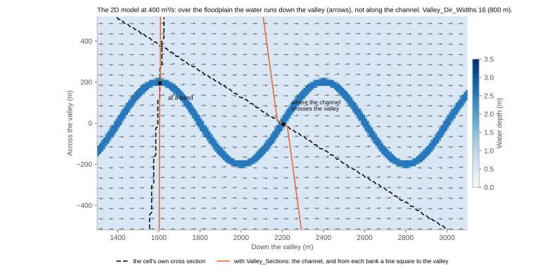
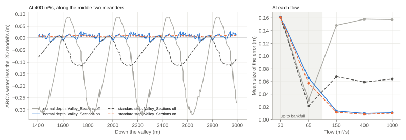
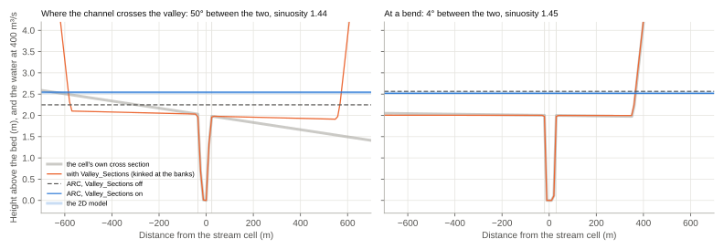
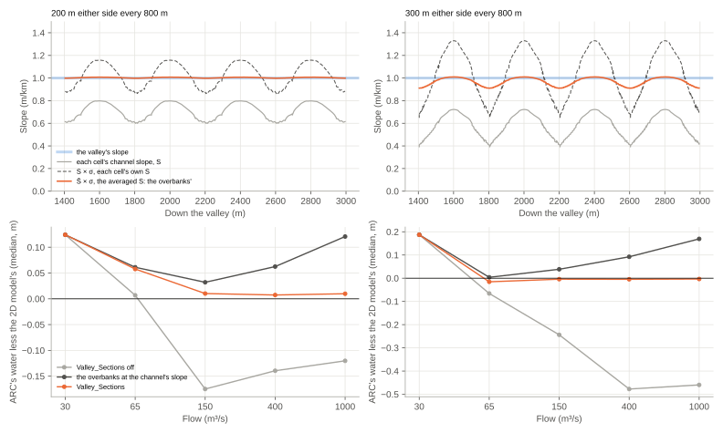

# Valley Cross Sections

Manning's equation takes the water to flow square to the cross section, down the slope in that direction. ARC draws
each stream cell's cross section square to the stream there, which is right for the water in the channel. Over the
floodplain of a meandering river it isn't: a flood runs straight down the valley, across the channel's loops. With
`Valley_Sections`, each cross section keeps its channel, and takes each overbank from a line out from that bank square
to the valley, at the valley's slope. It is off by default.

!!! tip "When to use it"
    Turn it on for meandering rivers with wide floodplains, where a flood runs down the valley across the channel's
    loops: on synthetic meanders it cut ARC's error over the floodplain from 0.15 m to 0.012 m. On straight or
    confined streams it changes nothing worth its cost, about a quarter more run time, and on 68 real sites the flood
    maps came out the same with it as without (see [On real rivers](#on-real-rivers)).

## Why the direction matters

The figure shows a 2D model of the flow through a synthetic valley: a channel 40 m wide and 2 m deep winding 200 m
either side of the valley's axis every 800 m, in a floodplain 1.1 km wide falling 0.001, with n 0.04 everywhere. At
400 m³/s the water is about half a metre deep over the floodplain, and the arrows show the way it moves: straight down
the valley, over the channel's loops.

At a bend the channel runs down the valley, and the cell's own cross section (dashed) is square to the valley too.
Where the channel crosses the valley, its cross section cuts the floodplain at a slant: the floodplain looks wider than
it is, by one over the cosine of the angle, and carries too much water at each level. And the slope ARC takes is the
channel's, gentler than the valley's by the stream's sinuosity, the length along the stream over the length down the
valley. So ARC's water over the floodplain swings from one meander to the next, too low where the channel crosses the
valley and too high at the bends.

The 2D model is the local inertial scheme of LISFLOOD-FP (Bates, Horritt & Fewtrell, 2010; de Almeida & Bates, 2013),
run until the flow is steady, with the same DEM and n. It leaves out the velocity head, 3 to 12 cm in the channel.
Solving the full shallow water equations instead would put it in, but on 10 m cells a channel four cells wide crossing
the grid loses momentum at each stair step of its banks, which raised the channel's water 0.41 m at 30 m³/s (see
[Running the Tests](testing_unit_tests.md#the-2d-model)). On a straight valley, with the same channel running straight
down it, ARC's water over the floodplain is within 1 to 3 cm of the 2D model's. In the channel ARC's stands 0.15 m
higher, with or without `Valley_Sections`: the 2D model sees the trapezoid as blocks of 10 m cells. On the meanders:

With each cell's own cross section, ARC's water over the floodplain swings from 0.3 m too low to 0.1 m too high, and is
out by 0.15 m on average. The standard step evens out the swings, as each cross section's water is tied to the next,
but leaves the water 0.06 m too low on average. With `Valley_Sections`, the valley's direction taken over 16 channel
widths of the stream either way (the default: 800 m, the channel being 50 m between ARC's banks), it is out by
0.012 m, and 0.010 m with the standard step.
`testing/test_valley_sections.py` checks this, against the 2D model's water at each stream cell, kept in
`testing/data/valley_meander_2d.npz`; `testing/synthetic_valley.py` builds the valley, and `testing/shallow_water.py`
is the 2D model, which `testing/test_shallow_water.py` runs through HEC-RAS's verification tests (see
[Running the Tests](testing_unit_tests.md#the-2d-model)).

## How it works

1. **The valley's direction and the stream's sinuosity** (`arc.xsection.valley.valley_axes`). Each step from one of
   the reach's stream cells to the next, by their distances along the stream (see
   [Stream Slope Methods](stream_slope_methods.md)), is weighted by a Gaussian of half the window (see
   [The window](#the-window)) along the stream either side of the cell. The valley runs the way of the weighted sum of the steps, and the sinuosity is
   their weighted length over the sum's. Where the channel crosses the valley one way, it crosses it back further on,
   and those steps cancel: a straight line between the cells either side, or a line fitted to the cells in a box
   around the cell (as `Gen_Dir_Dist` takes the stream's direction), swings with the meanders unless it spans a whole
   number of them, while the Gaussian's error only falls as it lengthens.
2. **The overbanks** are a line from each of the cell's own banks, square to the valley, out as far as the cell's own
   cross section reaches (to the first ground above the lower of its ends), and further when the water would rise
   above them. With the channel between the banks, the cross section is one line across the valley, kinked at the
   banks, however far the valley turns from the cell's own cross section.
3. **Other water** along the lines, the stream raster's cells and the water mask's water (`BathyWaterMask`, if given;
   not the land cover's water), is filled to the lower of the dry ground either side: where the river winds back on
   itself, the lines cross its other bends, whose flow below their banks is the channel's flow again, and the water in
   lakes and other streams isn't the river's flowing down the valley.
4. **The profile** (`arc.xsection.valley.splice`). The hydraulics take the cell's own cross section between its banks,
   a vertex at each bank on its ground, and beyond each bank its line's ground, as far beyond the bank as along the
   line.

    

5. **The valley's slope** (`arc.xsection.valley.slope_ratio`). The water falls as far down the valley as along the
   channel, over a shorter length, so the valley's slope is the channel's times the sinuosity:
   $S_v = S \times \sigma$. A cell's own channel slope $S$ is taken over `Gen_Slope_Dist` cells, steeper where the
   channel runs down the valley and gentler where it crosses it, so $S_v$ takes the channel's slope averaged over the
   same stretch as the sinuosity, $\bar{S}$: $S_v = \bar{S} \times \sigma$. ARC's hydraulics take one slope, the
   channel's, so the overbanks' Manning's n is divided by $\sqrt{S_v / S}$ instead. Manning's discharge is
   $Q = A R^{2/3} S^{1/2} / n$, so

    $$\frac{A R^{2/3} S_v^{1/2}}{n} = \frac{A R^{2/3} S^{1/2}}{n / \sqrt{S_v / S}}$$

    at any depth (with `Depth_Varying_N` too, which scales n): the overbanks carry what they would at the valley's
   slope. Where the channel slope is even, $S_v / S$ is the sinuosity, and n is divided by $\sqrt{\sigma}$. It's what
   HEC-RAS does with an overbank's flow length shorter than its channel's.

    On the synthetic meanders, $S \times \sigma$ with each cell's own slope swings from 12% below the valley's slope
   to 16% above it (from 29% below to 28% above on the tightest), and $\bar{S} \times \sigma$ is within 1% of it (from
   9% below to 1% above). With the overbanks at the channel's own slope, ARC's water over the floodplain stands up to
   0.12 m too high (0.17 m on the tightest).

    

The rating curves, the VDT database and the standard step all take the profile with the lines. The VDT database
also gives each cell's valley slope, $\bar{S} \times \sigma$ as the overbanks take it (`Valley_Slope`; `Slope` where the
cross section is left as it is), and Curve2Flood works out the velocity over the floodplain from it. With the stream's
own slope there, its velocities over the synthetic meanders' floodplains come out about $1/\sqrt{\sigma}$ of the 2D
model's.

A cross section is left as it is where it is within a degree of square to the valley and the sinuosity is under
1.005, as on a straight stream, and so are manual cross sections and those without banks. The cross-section file (`XS_Out_File`)
keeps each cell's own cross section.

## The window

`Valley_Dir_Widths` sets how far along the stream, either way, the valley's direction and the stream's sinuosity are
taken: 16 of the reach's channel widths by default, a reach's width being the median distance between its cross
sections' banks. It should span about a meander: a meander runs 10 to 14 channel widths down its valley (Leopold &
Wolman, 1960), and further along the winding stream. Shorter, the valley's direction follows the channel's bends, and
little changes; longer is safe, until it reaches round the valley's own bends. A window measured in channel widths
grows with the river, where one a fixed number of cells long spans a whole meander of a small river and part of one
of a big river. `Valley_Dir_Dist` (40 cells) is the window of a reach without banks, and of every reach with
`Valley_Dir_Widths` 0.

The widths are the bank tops' in every mode. Banks closer in shorten the window by the
same share: on synthetic meanders of natural proportions, a window of 10 true channel widths turned the valley a
median 8° from its axis, and one of 6 widths 26°, against 0.4° at 16. Before 0.5.0, a run without bathymetry took
the water mask's edge for its banks, the low water's, which on the synthetic channels was a median 0.6 to 0.75 of the
bank tops' width. With bathymetry and without `Bathy_Use_Banks` the channel is carved between the DEM's water's edges, but the hydraulics, and so the window, take the bank tops.

The table gives the mean size of ARC's error over the floodplain (at 150, 400 and 1000 m³/s, in metres) on seven
synthetic valleys with 10 m cells, each with four meanders: the four above, whose meanders are long for their channel,
and three of natural proportions, the last with a channel 80 m wide. The channel's width is ARC's, between its banks
(50 m for the channel 40 m wide at the top), with how many of those widths a meander runs down the valley:

| Meanders (sinuosity) | Channel width (m), widths a meander | Normal depth: off | 40 cells | 80 cells | 16 widths | Standard step: off | 40 cells | 80 cells | 16 widths |
|---|---|---|---|---|---|---|---|---|---|
| 100 m every 800 m (1.13) | 50, 16 | 0.039 | 0.009 | 0.010 | 0.010 | 0.020 | 0.005 | 0.010 | 0.010 |
| 200 m every 800 m (1.45) | 50, 16 | 0.155 | 0.054 | 0.012 | 0.012 | 0.064 | 0.026 | 0.010 | 0.010 |
| 300 m every 800 m (1.85) | 50, 16 | 0.326 | 0.207 | 0.031 | 0.031 | 0.101 | 0.064 | 0.012 | 0.012 |
| 400 m every 1600 m (1.46) | 50, 32 | 0.200 | 0.155 | 0.084 | 0.084 | 0.081 | 0.069 | 0.046 | 0.046 |
| 110 m every 440 m (1.42) | 50, 9 | 0.110 | 0.012 | 0.014 | 0.014 | 0.043 | 0.009 | 0.012 | 0.012 |
| 165 m every 440 m (1.83) | 50, 9 | 0.280 | 0.029 | 0.013 | 0.013 | 0.069 | 0.009 | 0.015 | 0.015 |
| 220 m every 880 m (1.45) | 90, 10 | 0.110 | 0.056 | 0.060 | 0.068 | 0.046 | 0.033 | 0.065 | 0.072 |

On the first two meanders of natural proportions, 16 widths comes within 2 mm of the better of the fixed windows at
normal depth, and within 6 mm with the standard step, and finds the valley's direction within a degree. On the long meanders, 32 widths a meander, it is too short, as 80 cells is. With
the channel 80 m wide, 40 cells scores best, but by chance: its valley runs up to 42° off and its sinuosity is 15% low,
where 16 widths finds both. Its error there is mostly at 150 m³/s, about that channel's bankfull flow (see the limit
below).

On a 30 m DEM, ARC can't see a channel narrower than about two cells, so a small stream's width comes out at about
55 m, and its window at about 30 cells (0.9 km). On a 1° tile of the Colorado River's basin (N39W109), half the
reaches' windows are 33 cells or fewer, and the Colorado's own, 160 m between its banks, is 94 cells (2.6 km).

## On real rivers

On 68 sites with observed flood maps (406 maps, scored by the Matthews correlation coefficient), `Valley_Sections`
changes the maps by nothing to speak of: −0.0002 with the standard step (a 95% interval of −0.0024 to +0.0018), and
−0.0006 without it (−0.0027 to +0.0015); at the 23 most meandering sites, −0.0013 with the standard step (−0.0063 to
+0.0028). The maps are drawn from each reach's water at its median stage, and the changes to the water surfaces go both
ways. Where a channel winds tightly, the cell's own cross section can run down the valley floor, through the river's
other bends, and the lines square to the valley raise its water by up to a metre. But they also reach ground the cell's
own cross section doesn't, such as a low flat beside the river, and with the standard step a change at a reach's outlet
carries up the reach. On a 1° tile (43,000 cross sections) it adds about a quarter to ARC's run time (12.9 to 16.0 s, with the
standard step and 30 increments).

Near bankfull, as the water first spreads over the floodplain, it still follows the channel, and `Valley_Sections`
takes it down the valley from the start: on the synthetic meander, ARC's water at bankfull stands 6 cm above the 2D
model's with `Valley_Sections`, against 1 cm without.

## References

Leopold, L. B., & Wolman, M. G. (1960). River meanders. Geological Society of America Bulletin, 71(6), 769–794.

Bates, P. D., Horritt, M. S., & Fewtrell, T. J. (2010). A simple inertial formulation of the shallow water equations
for efficient two-dimensional flood inundation modelling. Journal of Hydrology, 387(1–2), 33–45.

de Almeida, G. A. M., & Bates, P. (2013). Applicability of the local inertial approximation of the shallow water
equations to flood modeling. Water Resources Research, 49(8), 4833–4844.
